# Wasser-Look: Anleitung

Stand 14.11., 12:30 Uhr. Für alle, die den Wasser-Look ansehen, anwenden oder weiter in die App einbauen.
**Am Handy ist der Look eingebaut und live** (seit 14.11.; Commit `c7e8299`, seither auf `main`). **Der Desktop ist in Arbeit** (Branch `welt/wasser-desktop`) und bleibt unverändert, bis der Besitzer ihn an seinem Bildschirm gesehen hat. Was getan ist und was als Nächstes kommt: Abschnitt 8. Der Stand bewegt sich – 8.1 sagt, wie man ihn nachsieht.

| Was | Wo |
|---|---|
| Die Vorlage (drei Stylesheets, ein Skript) | `docs/wasser-look/vorlage/`: `kern.css`, `mobil.css`, `desktop.css`, `wasser.js` |
| Die Werkzeuge (ansehen, prüfen, messen) | `scripts/wasser/` – jede Datei erklärt sich in ihrem Kopf |
| Die Bilder | `docs/wasser-look/bilder/mobil/`, `…/desktop/`, `…/anleitung/` |
| Die Entscheidungen des Besitzers | `docs/wasser-look/entwurf/entscheidungen.md` – gehen allem anderen vor |
| Das Notizbuch der Erbauer (englisch, alle Zahlen) | `docs/wasser-look/vorlage/NOTIZEN.md` |

Inhalt: [1 Was der Look ist](#1-was-der-look-ist) · [2 Entscheidungen](#2-entscheidungen-des-besitzers-binden-alle) · [3 Ansehen](#3-beide-vorlagen-ansehen-ohne-die-app-anzufassen) · [4 Bausteine](#4-die-bausteine) · [5 Dosierung](#5-dosierung) · [6 Töne](#6-töne-und-modi) · [7 Bewegung](#7-bewegung) · [8 Fahrplan](#8-fahrplan-der-look-in-der-app) · [9 Fallstricke](#9-fallstricke) · [10 Offen](#10-ungeprüft-und-offen) · [11 Geprüft](#11-was-an-dieser-anleitung-geprüft-wurde)

Alle Befehle laufen aus dem Projektordner. Ausgaben gehen nach `screenshots/` (nicht im Git).

---

## 1. Was der Look ist

1. **Knöpfe sind Tropfen aus klarem Wasser.** Frei über der Landschaft brechen sie das Bild dahinter. Auf einer Karte zeigen sie das Wasser der Karte.
2. **Karten und Panels sind flache Becken aus stillem Wasser:** am Rand klar, in der Mitte tiefer. Unter jedem Tropfen sammelt sich Licht.
3. **Eine Berührung** beantwortet das Becken mit einem dünnen Ring.
4. **Menüleiste (Handy) und Dock (Desktop)** sind dichtes Wasser. Eine Perle fließt zum aktiven Reiter.
5. **Bögen, Felder, Etiketten, Haken, Fortschritt, Hinweis und Suche** bekommen eine abgemessene Dosis: Form und ein heller Rand, kein Glanz.
6. **In Ruhe** wandert Licht an den Rändern. Scrollen zieht das Licht mit. Nach 30 s ohne Berührung ruht alles.
7. **Mit „Bewegung reduzieren“** steht alles still.
8. **Zwei Töne:** „dunkel“ ist der dunkle Modus (Standard), „klar“ der helle Modus. Die Schrift ist in beiden hell.
9. **Am Desktop** bleiben Inseln, ihre Namen, der Tagesring und lose Schrift über der Landschaft unberührt.
10. **Der Look ist ein Aufsatz:** eingeschaltet durch das Attribut `data-wasser` am Wurzelelement. Ohne das Attribut ist die App, wie sie war.

| | Ton „dunkel“ | Ton „klar“ |
|---|---|---|
| **Handy**, Vorschauseite | [dunkel-start](wasser-look/bilder/mobil/dunkel-start.webp) · [alle Szenen](wasser-look/bilder/mobil/dunkel-szenen.webp) | [klar-start](wasser-look/bilder/mobil/klar-start.webp) · [alle Szenen](wasser-look/bilder/mobil/klar-szenen.webp) |
| **Handy**, echte App (zwölf Bildschirme) | [dunkel-app](wasser-look/bilder/mobil/dunkel-app.webp) · [einer groß](wasser-look/bilder/mobil/dunkel-app-heute.webp) | [klar-app](wasser-look/bilder/mobil/klar-app.webp) · [einer groß](wasser-look/bilder/mobil/klar-app-heute.webp) |
| **Handy**, Knöpfe aus der Nähe | [dunkel-nah](wasser-look/bilder/mobil/dunkel-nah.webp) | [klar-nah](wasser-look/bilder/mobil/klar-nah.webp) |
| **Handy**, die kleinen Bausteine | [dunkel-alles](wasser-look/bilder/mobil/dunkel-alles.webp) | [klar-alles](wasser-look/bilder/mobil/klar-alles.webp) |
| **Desktop**, 2000 × 993 | [Start](wasser-look/bilder/desktop/dunkel-1-start.webp) · [Heute](wasser-look/bilder/desktop/dunkel-2-heute.webp) · [Projekte](wasser-look/bilder/desktop/dunkel-3-projekte.webp) · [Innenwelt](wasser-look/bilder/desktop/dunkel-4-innenwelt.webp) · [3D-Druck](wasser-look/bilder/desktop/dunkel-5-druck.webp) · [Material](wasser-look/bilder/desktop/dunkel-6-material.webp) · [Wetter](wasser-look/bilder/desktop/dunkel-7-wetter.webp) · [Archiv](wasser-look/bilder/desktop/dunkel-8-archiv.webp) | [Heute bei Tag](wasser-look/bilder/desktop/klar-heute.webp) · [Heute bei Nacht](wasser-look/bilder/desktop/klar-heute-nacht.webp) · [Projekte](wasser-look/bilder/desktop/klar-projekte.webp) · [Wetter](wasser-look/bilder/desktop/klar-wetter.webp) |
| **Desktop**, 1920 × 1080 | [Material](wasser-look/bilder/desktop/format-1920-material.webp) · [Innenwelt](wasser-look/bilder/desktop/format-1920-innenwelt.webp) | |
| **Desktop**, heute gegen Vorlage | [Heute](wasser-look/bilder/desktop/vorher-nachher-heute.webp) · [Schublade](wasser-look/bilder/desktop/vorher-nachher-bogen.webp) | [bei Tag](wasser-look/bilder/desktop/vorher-nachher-tag.webp) |

Bewegung als Bildstreifen: Handy [Reiterwechsel](wasser-look/bilder/mobil/film-tab.webp), [Knopfdruck mit Ring](wasser-look/bilder/mobil/film-druck.webp), [Bogen steigt](wasser-look/bilder/mobil/film-bogen.webp); Desktop [Dock, Schublade, Ruhe](wasser-look/bilder/desktop/film-1.webp), [Ring, Mauszeiger](wasser-look/bilder/desktop/film-2.webp), [Pfeil, Lauflinie](wasser-look/bilder/desktop/film-3.webp).
Filme: [mobil.mp4](wasser-look/bilder/mobil/mobil.mp4), [desktop.mp4](wasser-look/bilder/desktop/desktop.mp4) – auf der Arbeitsmaschine aufgenommen, daher ruckelig.

---

## 2. Entscheidungen des Besitzers (binden alle)

Quelle: `docs/wasser-look/entwurf/entscheidungen.md`. Bei Widerspruch gilt die Entscheidung, nicht diese Anleitung.

1. **Knöpfe auf einer Karte zeigen das Wasser der Karte.** Nur Knöpfe frei über der Szene brechen die Landschaft.
2. **Kein Blau.** Farben, die etwas bedeuten (Statuspunkte, Materialnamen, Diagramme), bleiben.
3. **Rot von „Löschen“:** tiefer und ruhiger im Ton „dunkel“, klares Rot im Ton „klar“.
4. **Beide Töne bleiben, als die zwei Modi der App.** Dunkler Modus = Ton „dunkel“. Heller Modus = Ton „klar“. Die Einstellung „Erscheinungsbild“ wählt ihn, auf Handy und Desktop: Dunkel → „dunkel“, Hell → „klar“, Automatisch → nach dem Look der Stunde (`DARK_LOOKS` in `src/scene/looks.ts`). Das alte helle Thema der App (helle Flächen, dunkle Schrift, `:root[data-theme="hell"]`) ist **nicht** der helle Modus.
5. **Alles ist bewegt, aber ruhig:** lebt in Ruhe, antwortet auf Berührung und Scrollen. Aus bei reduzierter Bewegung.
6. **Erst die Vorlage.** Zwei Vorlagen zum Ansehen (Handy, Desktop) mit Anleitung; die App wird erst geändert, wenn er es sagt. (Fürs Handy hat er es gesagt: Nummer 9.)
7. **Leben in Ruhe: Die Stärke bleibt 1, das Tempo wird ein wenig schneller** (14.11.). Ein wenig schneller als gebaut (24 / 34 / 40 / 46 s je Runde), deutlich weniger als der gezeigte 2,5-fache Versuch. Bauen und ihm zeigen, bevor es live geht.
8. **Der helle Modus („klar“) wird ein wenig durchsichtiger** (14.11.). „Heller“ heißt: mehr von der Szene durch das Wasser, nicht eine hellere Farbe. Vorerst nur „klar“; „dunkel“ bleibt. Am Desktop, wahrscheinlich auch am Handy. Innerhalb der Grenzen der Lesbarkeit (Titel 7, Text 4,5, Platzhalter 3). Bauen und ihm zeigen.
9. **Die Handy-Version ist live** (14.11.). Der Desktop bleibt unverändert, bis er den Desktop-Einbau an seinem eigenen Bildschirm gesehen hat.
10. **Weiches Gehen** (14.11.): Bögen und Schubladen sollen weich schließen, abgehakte oder entfernte Zeilen weich verschwinden. Das braucht kleine Änderungen in der App und wird nach den Einbauten gebaut, für Handy und Desktop.
11. **Erster Lauf am echten Handy** (14.11., Baustelle): „läuft … alles sehr schön flüssig“. Offen: Nach dem Tipp auf einen Reiter dauert es einen Moment, bis der Bildschirm wechselt – ansehen und kürzen, oder wenigstens sofort unter dem Finger beantworten.

Dazu die Regeln des Projekts (`CLAUDE.md`): Nur der Hauptchat baut, deployt und führt `main` zusammen. Deutsche Oberfläche, englischer Code. Layout immer in 1920 × 1080 und 2000 × 993 prüfen. Neues muss in beiden Bereichen laufen, auch im leeren „Meine Werkstatt“. Bilder erzeugt nur der Besitzer – der Look braucht keine neuen.

---

## 3. Beide Vorlagen ansehen, ohne die App anzufassen

### Beide in der echten App (der beste Weg)

```
npm run build
node scripts/wasser/desktop.mjs zeigen
```

Dann http://localhost:4320 öffnen. Das ist die gebaute App mit der Vorlage obendrauf. Strg+C beendet.
`zeigen` liefert `dist/` selbst aus und braucht keine laufende Vorschau. `npm run build` kann entfallen, wenn `dist/` aktuell ist (seit dem letzten Build nichts in `src/` geändert).
Gedacht für einen Stand, in dem der Look noch nicht eingebaut ist (dieser Branch; auf `main` der Desktop). Wo er eingebaut ist, zeigt ihn `npm run preview` von selbst – am Handy auch die Live-Seite.

- Breites Fenster = Desktop-Vorlage. Schmales Fenster (unter 900 px) = Handy-Vorlage.
- Am Desktop folgt der Ton der Einstellung „Erscheinungsbild“. Fest wählen: `?ton=klar` oder `?ton=dunkel` vor das `#` hängen, z. B. `http://localhost:4320/?ton=klar#/heute`.
- Im schmalen Fenster ist der Ton „dunkel“, bis man `?ton=klar` anhängt (die mobile App verlangt heute immer das dunkle Thema).
- `?ohne=1` – die App wie heute, zum Vergleichen. `?weich=aus` – die Vorlage ohne Weichzeichner. `?leben=1.5` – mehr Licht in Ruhe.

### Die Handy-Vorschauseite (ein Nachbau des mobilen Bildschirms mit den echten Stylesheets)

```
python3 -m http.server 4311
```

Dann im schmalen Fenster (oder Handy-Ansicht der Entwicklerwerkzeuge, 390 × 844) öffnen. Jeder freie Port geht.

- http://localhost:4311/scripts/wasser/mobil.html – Ton „dunkel“
- http://localhost:4311/scripts/wasser/mobil.html?ton=klar – Ton „klar“
- `&scene=start|heute|projekte|material|druck|wetter|archiv|innen` – das Bild dahinter
- `&alles=1` – ein Bogen mit allen kleinen Bausteinen. `&nah=1` – Knöpfe aus der Nähe (breites Fenster). `&fallback=1` – ohne WebGL. `&ohne=1` – die App wie heute.
- `&vorlage=<Ordner>` – eine andere Kopie der Vorlage, z. B. eine, an der man gerade etwas ausprobiert (4.1). Der Ordner muss im Projektordner liegen; der Pfad zählt ab dort.

### Bilder und Filme selbst erzeugen

Die Werkzeuge spielen die Vorlage in die gebaute App ein. Dafür muss die Vorschau der App laufen (zweites Terminal):

```
npm run build && npm run preview
```

Läuft sie schon (Port 4173 ist belegt) und ist `dist/` aktuell, ist nichts zu tun.

```
node scripts/wasser/bild.mjs screenshots/wasser/mobil                    # Handy: acht Szenen, Nahaufnahmen, echte App, beide Töne
node scripts/wasser/film.mjs screenshots/wasser/mobil-film               # Handy: Bewegung als Bildstreifen
node scripts/wasser/clip.mjs screenshots/wasser/mobil.mp4                # Handy: kurzer Film
node scripts/wasser/desktop.mjs bild screenshots/wasser/desktop --alles  # Desktop: Welten, Bögen, Suche, Hinweis, leere Werkstatt
node scripts/wasser/desktop.mjs film screenshots/wasser/desktop-film     # Desktop: Bewegung als Bildstreifen
node scripts/wasser/desktop.mjs clip screenshots/wasser/desktop.mp4      # Desktop: Rundgang als Film
```

Schalter der Desktop-Bilder: `--format 1920` (sonst 2000 × 993), `--ton klar`, `--zeit tag` (sonst Nacht), `--nur heute,wetter`, `--look ohne` (die App wie heute).
Bewegung nie aus einem Standbild beurteilen: dafür sind die Bildstreifen da.

Wer kein Browserfenster hat, sieht die Vorlagen über diese Bilder an. Ein einzelnes Bild, in Sekunden: `node scripts/wasser/stelle.mjs screenshots/wasser/heute.png --welt heute` (Desktop; mit `--mobil` das Handy, mit `--ton klar` der helle Modus; mehr in 4.7). Eine beliebige Adresse – auch eine von `zeigen` oder `mobil.html` – fotografiert `node scripts/shot.mjs '<Adresse>' <bild.png> 390 844`; bei schmalen Seiten wartet es 15 s und meldet „scene not ready“, das Bild stimmt trotzdem.

---

## 4. Die Bausteine

Der Look besteht aus Bausteinen. Jeder Baustein ist **eine** Regel in `kern.css` (Teil 4) mit **einer** Liste von Selektoren. Alles, was dazugehört (Pseudo-Elemente, gedrückter Zustand, „keine Bewegung“), steht in der Regel selbst. Ein Selektor an einer Stelle bekommt also alles.

### 4.1 Einen Baustein anwenden: zwei Wege

**Weg A – neutrale Klasse.** Dem Element die Klasse des Bausteins geben (`.wa-becken`, `.wa-mulde` …). Kein CSS anfassen, keine Option nötig: Das Skript kennt die neutralen Klassen schon.

**Weg B – Eintrag in die Liste.** Das Element behält seine Klasse. In `kern.css` den Baustein suchen (Suchwort steht bei jedem Baustein unten) und eine Zeile in seine Liste schreiben. Nennt der Baustein eine Option des Skripts, denselben Selektor dort eintragen: in `wasser.js`, ganz oben, im Objekt `MOBIL`.

Fünf Regeln für Weg B:

1. **Die neue Zeile kommt direkt unter die erste Zeile der Liste und endet mit einem Komma.** Dahinter ein Vermerk: `/* mobil: Merkzettel */`, `/* desktop: … */` oder, wenn es beide Hüllen trifft, `/* both shells: … */`.
2. **Ein Eintrag ist nie schwerer als der schwerste, der schon in der Liste steht.** Was er darüber hinaus braucht, kommt in `:where()` – das wiegt nichts: `.panel .glass:where(.col)`.

   | Gewicht der Liste | Bausteine |
   |---|---|
   | eine Klasse | Etikett, Etikett auf Wasser, dichtes Wasser, Markierung, Bogen, Feld, Haken, Pegel |
   | zwei Klassen | alle anderen |
   | drei Klassen | nur Perle (`.btn.btn--icon.btn--ghost`) |

3. **Eine Klasse, die beide Hüllen haben, gilt sonst für beide.** Nur für eine: mit einer Klasse dieser Hülle in `:where()` eingrenzen, z. B. `:where(.topbar) .brand`.
4. **Optionen:** `MOBIL` gilt auch am Desktop – außer bei den acht Optionen, die `DESKTOP` (gleich darunter) ersetzt: `scene`, `shade`, `drops`, `ringOn`, `ringFrom`, `bar`, `light`, `scrollers`. Kommt das Element in beiden Hüllen vor, dort in beide eintragen.
5. **Maße und Platz bleiben Sache der App** (Innenabstand, Breite, Höhe, `position`). Was eine Hülle an einem Baustein ändert, steht in `mobil.css` oder `desktop.css` – mit mindestens dem Gewicht der Liste (siehe 4.4).
   Fehlt einem Element der App, was sein Baustein „braucht“ (meist der Innenabstand): Die Hülle darf es dort geben. Dann rückt sein Inhalt – das ist eine sichtbare Änderung am Platz und gehört dem Besitzer als Bild vorher/nachher gezeigt. Nie an Panels, Titeln, Kopfzeile oder Inseln: Deren Platz bleibt wie in der App (`desktop.mjs pruefen`, „nichts ist verrückt“). Die Vorlage selbst gleicht bisher nur aus (etwa 1 px mehr Innenabstand, wo ein Rand von 1 px wegfällt).

Nach jedem Rezept:

```
node scripts/wasser/vergleich.mjs bilder --alt git:HEAD   # nichts anderes darf sich geändert haben (Handy). Nur vor dem Commit richtig: Fallstrick 60
node scripts/wasser/pruefen.mjs --app                     # 60 Prüfungen, etwa eine Minute
node scripts/wasser/desktop.mjs pruefen                   # 24 Prüfungen, wenn der Desktop betroffen ist
```

**Ausprobieren, ohne die Vorlage zu ändern: in einer Kopie.**

```
mkdir -p screenshots/wasser && cp -r docs/wasser-look/vorlage screenshots/wasser/probe    # screenshots/ ist nicht im Git
```

In der Kopie ändern. Jedes Werkzeug mit einem Look nimmt sie mit `--look screenshots/wasser/probe` (ein Ordner außerhalb des Projekts geht auch, mit ganzem Pfad). Die drei Befehle heißen dann:

```
node scripts/wasser/vergleich.mjs bilder --alt docs/wasser-look/vorlage --look screenshots/wasser/probe   # die Kopie gegen die Vorlage
node scripts/wasser/pruefen.mjs --app --look screenshots/wasser/probe
node scripts/wasser/desktop.mjs pruefen --look screenshots/wasser/probe
```

Im eigenen Browser: `mobil.html?vorlage=screenshots/wasser/probe` und `node scripts/wasser/desktop.mjs zeigen --look screenshots/wasser/probe`. Taugt der Versuch, kommen dieselben Zeilen in die Vorlage (`diff -r docs/wasser-look/vorlage screenshots/wasser/probe` zeigt sie).

Ein zusätzliches Stylesheet statt der Kopie geht nicht: CSS kann die Liste eines Bausteins nicht aus einer anderen Datei erweitern. Eigene Regeln einer Hülle (4.4, 4.5) kommen ans Ende von `mobil.css` oder `desktop.css` der Kopie.

### 4.2 Das durchgehende Beispiel: ein „Merkzettel“

Ein erfundenes neues Stück der mobilen App. Die App schreibt nur Maße und Plätze – keine Farbe, kein Rand, kein Schatten:

```html
<section class="merk">
  <div class="merk__kopf"><b>Merkzettel</b><span class="pill">3 offen</span><button class="merk__plus">+</button></div>
  <div class="merk__zeile"><span class="merk__haken"></span><div><b>Düse reinigen</b><small>vor dem nächsten Druck</small></div><button class="merk__zu">×</button></div>
  <input class="merk__eingabe" placeholder="Neuer Eintrag">
  <div class="merk__wahl"><button class="on">Heute</button><button>Woche</button><button>Alle</button></div>
  <div class="merk__stand"><i style="width: 40%"></i></div>
  <button class="merk__knopf">Hinzufügen</button>
</section>
<div class="merk-tafel"><b>2 erledigt</b><small>diese Woche</small></div>
<nav class="merk-leiste"><button class="on">Offen</button><button>Erledigt</button><button>Alle</button></nav>
```

```css
.merk { position: relative; padding: 15px; }
.merk__plus { width: 40px; height: 40px; }
.merk__zeile { display: flex; align-items: center; gap: 12px; padding: 12px 14px; }
.merk__haken { width: 26px; height: 26px; border-radius: 50%; }
.merk__zu { width: 30px; height: 30px; }
.merk__eingabe { width: 100%; padding: 12px 14px; font-size: 16px; }
.merk__wahl > button { padding: 7px 12px; }
.merk__stand { height: 6px; border-radius: 3px; overflow: hidden; }
.merk__stand > i { display: block; height: 100%; }
.merk__knopf { padding: 11px 18px; }
.merk-tafel { padding: 13px 16px; }
.merk-leiste { position: relative; display: flex; padding: 5px; border-radius: 28px; --wa-bar-tabs: 3; }
.merk-leiste > button { flex: 1; height: 44px; }
```

Mit den Zeilen aus 4.3 (18 in `kern.css`, 8 Optionen in `wasser.js`) wird daraus das Bild in der Mitte. Rechts derselbe Stand im Ton „klar“, ohne eine weitere Zeile; der Bogen unten trägt nur die neutralen Klassen (Weg A).

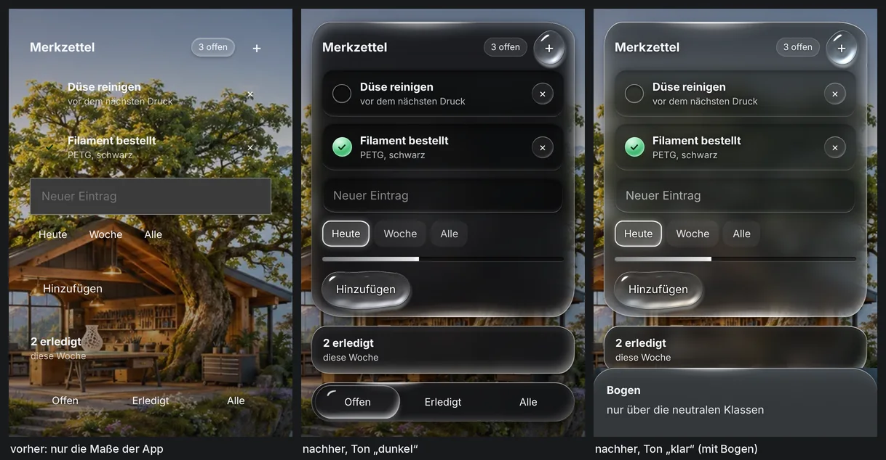

### 4.3 Die Bausteine einzeln

Suchwort = danach in `kern.css` suchen (mit `grep` wegen der Striche: `grep -n -e '-- Mulde' docs/wasser-look/vorlage/kern.css`). Stufe = wie viel Wasser (Abschnitt 5). Alle Bausteine auf fremden Elementen, nur über die neutrale Klasse: [bausteine](wasser-look/bilder/mobil/bausteine.webp).

#### Tropfen (Stufe 3) 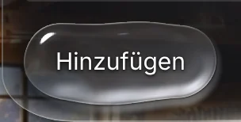 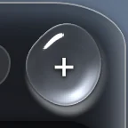

- **Was:** ein Knopf als Tropfen aus klarem Wasser. Ohne Skript ein schlichtes Glas; mit Skript ein lebender, lichtbrechender Tropfen (WebGL). Bernstein: Klasse `btn--primary`. Rot: `btn--danger`. Nah: [dunkel-nah](wasser-look/bilder/mobil/dunkel-nah.webp).
- **Wo:** Suchwort `-- Tropfen (.wa-tropfen)`. Skript: Optionen `drops` und `ringFrom`. Neutrale Klasse `.wa-tropfen`, rund `.wa-tropfen--rund`.
- **Braucht:** 14 px Platz ringsum, in dem nichts abschneidet (`overflow: hidden`).
- **Rezept:** Zeile in die Liste. Runde Knöpfe zusätzlich in die zwei Zeilen im Block, die mit `&:where(.wa-tropfen--rund,` beginnen (die erste macht ihn rund, die zweite gibt jedem zweiten runden Tropfen einen anderen Umriss). Selektor an `drops` hängen. Soll er auf einem Becken einen Ring schicken: auch an `ringFrom`.
- **Kein lebender Tropfen** (Knöpfe, die sich je Zeile wiederholen; viele auf einem Bildschirm): nur in die Liste, nicht in `drops`. Er bleibt schlichtes Glas – das ist Stufe 1: Form und heller Rand, kein WebGL, kein Weichzeichner, keine Bewegung in Ruhe.
- **Beispiel:**

  ```css
  [data-wasser] :is(
    .wa-tropfen,
    .merk__knopf, .merk__plus,                    /* mobil: Merkzettel */
  ```
  ```css
    &:where(.wa-tropfen--rund, .btn--icon, .m-ico, .merk__plus /* round drops: add further round elements here */) { … }
    &:where(.wa-tropfen--rund, .m-ico, .chip, .merk__plus):where(:nth-of-type(2n)) { … }
  ```
  ```js
  drops: '.btn:not(.btn--ghost):not(.m-row .btn, .item .btn), .m-ico, .wa-tropfen, .merk__knopf, .merk__plus',
  ringFrom: '… , .wa-becken .wa-haken, .merk__knopf, .merk .merk__haken',
  ```

#### Film (Stufe 1)

- **Was:** ein Geisterknopf bleibt ohne Rahmen. Nur unter dem Finger erscheint ein Film aus Wasser.
- **Wo:** Suchwort `-- Film:`. Eine einzelne Regel für `.btn.btn--ghost`, keine Liste.
- **Rezept:** dem Knopf die Klassen `btn btn--ghost` geben.

#### Becken (Stufe 2) 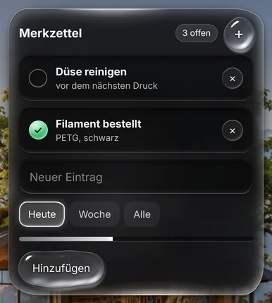

- **Was:** eine Fläche als flaches Becken: am Rand klar (die Szene scheint weich durch), nach innen zwei Stufen tiefer. Mit Randlicht, Bodenlicht und Ring.
- **Wo:** Suchwort `-- Becken (.wa-becken)`. Skript: `ringOn` (sein Boden zeigt den Ring) und `light` (es bekommt das Licht). Neutrale Klasse `.wa-becken`.
- **Braucht:** etwa 100 px in beide Richtungen; eigenen Innenabstand; eine `position` (es setzt selbst keine – `position: relative` genügt). Kleinere Flächen: „stilles Wasser“ nehmen, oder die Tiefe kleiner stellen wie `desktop.css` Teil 2 (`--wa-shelf-inset`, `--wa-deep-inset` …).
- **Beispiel:** `  .merk,                                        /* mobil: Merkzettel */` in die Liste; dazu

  ```js
  ringOn: '.glass.m-card, .wa-becken, .sheet, .merk',
  light: '.glass.m-card, .wa-becken, .sheet, .wa-bogen, .merk',
  ```

#### stilles Wasser (Stufe 2) 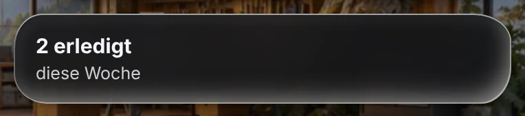

- **Was:** eine schlichte Fläche ohne Tiefenstufen, für alles, was für ein Becken zu klein ist (Zahlenkacheln, Wetterschilder).
- **Wo:** Suchwort `-- stilles Wasser (.wa-wasser)`. Keine Option. Neutrale Klasse `.wa-wasser`.
- **Braucht:** eigenen Innenabstand. Setzt keine Position.
- **Beispiel:** `  .merk-tafel,                                  /* mobil: Merkzettel, kleine Tafel */`

#### dichtes Wasser (Stufe 2)

- **Was:** das tiefe Ende desselben Wassers, fast deckend: für Flächen, unter denen Inhalt durchscrollt oder die eine Seite bedecken (Leiste, Dock, Bogen, Hinweis, Suche).
- **Wo:** Suchwort `-- dichtes Wasser (.wa-wasser--dicht)`. Keine Option. Neutrale Klasse `.wa-wasser--dicht`.
- **Braucht:** eigenen `border-radius` und Platz.
- **Beispiel:** `  .merk-leiste,                                 /* mobil: Merkzettel, Leiste */` (Bild bei „Markierung“)

#### Markierung, mit Atmen 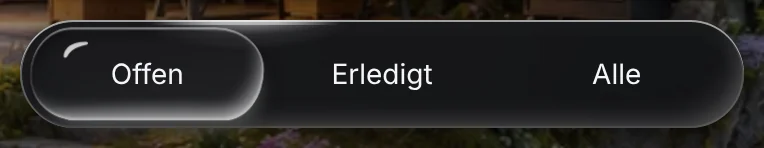

- **Was:** eine Perle aus klarem Wasser, die das aktive Kind einer Leiste markiert und zum nächsten fließt. In Ruhe atmet sie. Streifen: [film-tab](wasser-look/bilder/mobil/film-tab.webp).
- **Wo:** Suchwort `-- Markierung (.wa-markierung)`. Skript: `bar`; Klasse des aktiven Kinds: `tabOn` (heute `on`). Neutrale Klasse `.wa-markierung`.
- **Braucht:** gleich breite Kinder ohne Lücke (eine Flex-Zeile aus verschieden langen Wörtern ist das nicht: dann `flex: 1` oder ein Raster aus `1fr`-Spalten). Das aktive Kind trägt `on`. `--wa-bar-tabs: <Anzahl>` an der Leiste (bis neun). Eine `position` und `isolation: isolate` (die zweite bringt „dichtes Wasser“ mit).
- **Beispiel:** dieselbe Zeile `.merk-leiste,` in die drei Listen „dichtes Wasser“, „Markierung“, „Lichtlauf“; in der App `--wa-bar-tabs: 3`; dazu `bar: '.m-tabs, .wa-markierung, .merk-leiste',`

#### Bogen (Stufe 2) 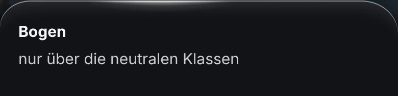

- **Was:** dichtes Wasser, das vom unteren Rand wie eine weiche Welle steigt und sich setzt; ein Lichtkamm läuft über seine Oberkante. Am Desktop dieselbe Fläche als Schublade von rechts. Streifen: [film-bogen](wasser-look/bilder/mobil/film-bogen.webp).
- **Wo:** Suchwort `-- Bogen (.wa-bogen)`. Skript: `ringOn`, `light`, `modal` (die Seite dahinter ruht), `scrollers` (sein rollender Inhalt). Neutrale Klassen `.wa-wasser--dicht.wa-bogen` (beide).
- **Braucht:** seinen Platz am unteren Rand, `overflow: hidden`, Innenabstand, einen Schleier dahinter (`.sheet-back`).
- **Rezept:** Die App hat nur einen Bogen (`.sheet`), er ist schon in den Listen. Ein neuer Bogen: die zwei neutralen Klassen, oder die Listen „dichtes Wasser“ und „Bogen“ samt den Optionen. Eine andere Form (Schublade): die Werte `--wa-r-bogen`, `--wa-bogen-rim`, `--wa-bogen-lift`, `--wa-bogen-fuss`, `--wa-kamm` für die Hülle neu setzen und einen anderen `animation-name` geben – `desktop.css` Teil 1 und 6 machen genau das vor.
- **Beispiel (Weg A):** `<div class="wa-wasser--dicht wa-bogen" style="position: absolute; left: 0; right: 0; bottom: 0; overflow: hidden; padding: 20px 18px 26px">…</div>`

#### Tropfen-Hinweis (Stufe 2)

- **Was:** der Hinweis am unteren Rand: ein kleines Stück dichtes Wasser, das wie ein Tropfen landet und wie einer geht. Bild: der letzte Bildschirm in [dunkel-app](wasser-look/bilder/mobil/dunkel-app.webp).
- **Wo:** Suchwort `-- Tropfen-Hinweis (.wa-hinweis)`. Skript: `toasts`. Neutrale Klassen `.wa-wasser--dicht.wa-hinweis`, Fehler zusätzlich `.wa-hinweis--fehler`.
- **Braucht:** Position und Innenabstand. Nie mit einem `transform` zentrieren (die Landung ist selbst eines): mit `margin: 0 auto`.
- **Rezept:** `.toast` ist schon in den Listen. Ein zweiter Hinweis: die neutralen Klassen.

#### Setzen

- **Was:** eine Fläche, die erscheint, kommt wie Wasser zur Ruhe: steigt ein wenig, läuft einen Hauch darüber hinaus, sinkt zurück.
- **Wo:** Suchwort `-- Setzen (.wa-setzt)`. Nur die Klasse `.wa-setzt`, keine Liste.
- **Rezept:** Klasse `wa-setzt` auf Flächen, die keinen eigenen Auftritt haben (im Bild [bausteine](wasser-look/bilder/mobil/bausteine.webp) die Fläche „dichtes Wasser“). Mehrere zugleich: `animation-delay: calc(var(--wa-t-step) * n)`. Nicht auf Elemente, die die App selbst hereinbewegt (Karten, Panels).

#### Mulde und Mulde zum Tippen (Stufe 1) 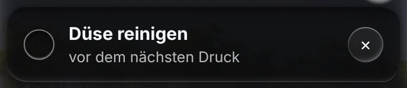

- **Was:** eine weiche, etwas tiefere Stelle im Boden einer Fläche: Zeilen und Zahlenkacheln. Die antippbare Mulde hat eine feine Lichtlinie und leuchtet unter dem Finger auf.
- **Wo:** Suchworte `-- Mulde (.wa-mulde)` und `-- Mulde zum Tippen (.wa-mulde--tipp)`. Keine Option. Neutrale Klassen `.wa-mulde`, antippbar zusätzlich `.wa-mulde--tipp`.
- **Braucht:** liegt auf einer Fläche; eigenen Innenabstand (hat das Element keinen: Regel 5 in 4.1).
- **Beispiel:** `  .merk__zeile,                                 /* mobil: Merkzettel */` in beide Listen (antippbar) oder nur in die erste.

#### Etikett und Etikett auf Wasser (Stufe 1) 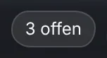

- **Was:** frei über der Szene ist ein Etikett eine kleine Glasperle. Auf einer Wasserfläche ist es ein flaches Schild, damit die Tropfen das Einzige bleiben, was glänzt.
- **Wo:** Suchworte `-- Etikett (.wa-etikett)` und `-- Etikett auf Wasser`. Keine Option. Neutrale Klasse `.wa-etikett`.
- **Rezept:** `.pill` ist schon ein Etikett. Die zweite Liste nennt die **Flächen**, auf denen eine `.pill` flach ist: eine neue Fläche dort eintragen.
- **Beispiel:** `  .merk,                                        /* mobil: Merkzettel */` in die Liste von „Etikett auf Wasser“.

#### Feld (Stufe 1) 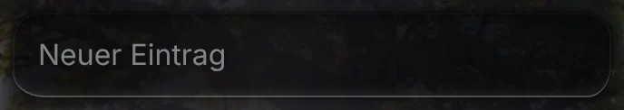 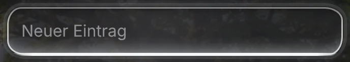

- **Was:** eine Mulde zum Hineinschreiben: Textfeld, Textbereich, Auswahl. Mit Fokus läuft die Wasserlinie ein und eine Lichtlinie umläuft das Feld. Tippen löst nie etwas aus.
- **Wo:** Suchwort `-- Feld (.wa-feld)`. Keine Option. Neutrale Klasse `.wa-feld`, eine Auswahl zusätzlich `.wa-feld--auswahl`.
- **Braucht:** Innenabstand, Schrift 16 px (iOS zoomt darunter). Keinen eigenen Rand. Eine Auswahl darf rechts keinen eigenen Innenabstand setzen (dort liegt der Pfeil).
- **Beispiel:** `  .merk__eingabe,                               /* mobil: Merkzettel */`

#### Wahl (Stufe 1) 

- **Was:** Schilder, von denen eines (oder mehrere) gewählt ist. Die Perle des gewählten fließt vom alten zum neuen.
- **Wo:** Suchwort `-- Wahl (.wa-wahl > *)`. Skript: `groups` (die **Gruppe**), Klassen eines gewählten Schilds: `chosen` (`on`, `pill--on`). Neutrale Klasse `.wa-wahl` an der Gruppe.
- **Braucht:** Innenabstand je Schild; das gewählte trägt `on`.
- **Beispiel:** `  .merk__wahl > button,                         /* mobil: Merkzettel */` und `groups: '.pills, .seg, .tabs, .tiles, .island-lib, .wa-wahl, .merk__wahl',`

#### Haken (Stufe 1) 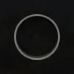 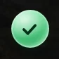

- **Was:** ein Kreis zum Abhaken. Leer eine kleine Vertiefung; abgehakt füllt ihn ein Tropfen grünes Wasser. Auf einem Becken schickt das Abhaken einen grünen Ring.
- **Wo:** Suchwort `-- Haken (.wa-haken)`. Skript: `tick` (was ein Haken ist), `ticked` (Klassen eines abgehakten: `check--on`, `on`), `ringFrom`. Neutrale Klasse `.wa-haken`, übersprungen `.wa-haken--aus`.
- **Braucht:** Breite, Höhe, `border-radius: 50%`. Das Häkchen selbst ist das SVG der App.
- **Beispiel:** `  .merk__haken,                                 /* mobil: Merkzettel */` und `tick: '.check, .wa-haken, .merk__haken',` (der Ring: siehe `ringFrom` bei „Tropfen“)

#### Pegel (Stufe 1) 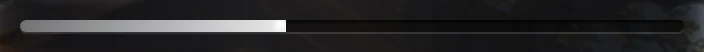

- **Was:** ein Fortschrittsbalken: Wasser in einem dünnen Glasröhrchen. Eine echte Änderung des Stands läuft mit einem kleinen Schwung hin.
- **Wo:** Suchwort `-- Pegel (.wa-pegel > i)`. Skript: `levels`. Neutrale Klasse `.wa-pegel`, Bernstein `.wa-pegel--amber`.
- **Braucht:** das Röhrchen: Höhe, Radius, `overflow: hidden`. Darin ein `<i>` mit `display: block; height: 100%` und der Breite in % als Inline-Stil.
- **Beispiel:** `  .merk__stand,                                 /* mobil: Merkzettel */` und `levels: '.progress, .wa-pegel, .merk__stand',`

#### Perle und Perle mit Schrift (Stufe 1) 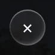

- **Was:** ein kleiner runder Zeichenknopf (schließen, entfernen, „mehr“) als Glasperle. Gibt unter dem Finger nach und federt zurück. „Perle mit Schrift“: Textknöpfe, die sich je Zeile wiederholen, sind flaches Glas statt Tropfen.
- **Wo:** Suchworte `-- Perle (.wa-perle)` und `-- Perle mit Schrift`. Keine Option. Neutrale Klasse `.wa-perle`.
- **Braucht:** Breite und Höhe (28 px und mehr). Achtung: Die Liste wiegt **drei** Klassen, und der Druck ist ein `transform` (Fallstricke 3 und 4).
- **Rezept „mit Schrift“:** Die Liste nennt die **Zeilen** (`.item`, `.m-row`, `.panel`), deren schlichte Knöpfe flach sind. Eine neue Art Zeile dort eintragen – und ihre Knöpfe aus `drops` und `ringFrom` heraushalten.
- **Beispiel:** `  .merk__zu,                                    /* mobil: Merkzettel */`

#### Ring 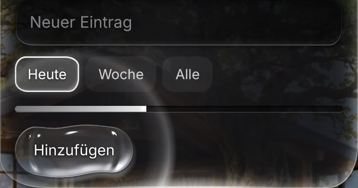

- **Was:** die Antwort auf einen Tipp: ein dünner Lichtring läuft über den Boden der Fläche, von der Stelle des Fingers aus. Er startet beim Loslassen. Streifen: [film-druck](wasser-look/bilder/mobil/film-druck.webp).
- **Wo:** Suchwort `-- Ring (.wa-floor > .wa-ring)`. Skript: `ringOn` (welche Flächen), `ringFrom` (welche Knöpfe und Haken ihn auslösen). Den Helfer baut das Skript.
- **Braucht:** die Fläche: `position` und `isolation: isolate` (Becken und Bogen haben das).
- **Rezept:** Fläche an `ringOn`, Auslöser an `ringFrom`. Ganz aus: `ringOn: ''`.

#### Wasserlinie 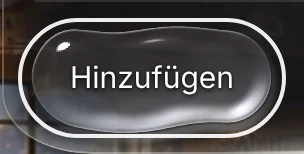

- **Was:** der Tastaturfokus ist eine weiße Lichtlinie außerhalb der Kontur, kein blauer Ring.
- **Wo:** Suchwort `-- Wasserlinie:` (der zweite Treffer, in Teil 4; der erste sind ihre Werte). Zwei Listen: mit Abstand um Tropfen und Etiketten, eng um alles andere. Am Desktop fängt `desktop.css` Teil 10 den Rest.
- **Beispiel:** `  .merk__knopf, .merk__plus,                    /* mobil: Merkzettel */` in die erste Liste, `  .merk__zeile, .merk__haken, .merk__zu, .merk__wahl > button, .merk-leiste > button,   /* mobil: Merkzettel */` in die zweite.

#### Licht, Bodenlicht, Lichtlauf (Leben in Ruhe)

- **Was:** Licht, das in Ruhe an den Rändern einer Fläche wandert (Licht), ein sehr weicher Fleck auf dem Boden eines Beckens (Bodenlicht), und dasselbe Randlicht für kleine oder dichte Flächen ohne Helfer (Lichtlauf). Beim Scrollen neigt sich das Licht (Zug), bei einer neuen Fläche schwingt es ein (Schwappen). In einem Standbild ist es der helle Strich auf der Oberkante jeder Karte; in Bewegung: [leben-vergleich](wasser-look/bilder/mobil/leben-vergleich.png), [film-tab](wasser-look/bilder/mobil/film-tab.webp).
- **Wo:** Suchworte `-- Licht (.wa-licht)` und `-- Lichtlauf (.wa-lichtlauf)`. Skript: `light` (Flächen mit Helfer), `scrollers` (Listen, deren Scrollen das Licht zieht). Neutrale Klasse für den Lichtlauf: `.wa-lichtlauf`.
- **Braucht:** die Fläche: `position` und `isolation: isolate`. Lichtlauf: ihr `::after` muss frei sein.
- **Rezept:** große Fläche → `light` (Becken und Bogen bekommen es so). Kleine oder dichte Fläche → Liste „Lichtlauf“. Kein Bodenlicht auf einer Fläche: `.meine-flaeche > .wa-licht > .wa-boden { display: none; animation: none; }`.
- **Beispiel:** `light: '…, .merk'` (bei „Becken“) und `.merk-leiste,` in der Liste „Lichtlauf“ (bei „Markierung“).

#### Ruhe

- **Was:** alles schläft gemeinsam ein und wacht gemeinsam auf (Abschnitt 7).
- **Wo:** Suchwort `Ruhe: asleep together`. Skript: `sleep` (30000 ms), `modal`.
- **Rezept für eine neue Schleife in Ruhe:** nur `transform` und `opacity`, auf einer eigenen Ebene, mit `animation-play-state: var(--wa-lauf)` und den zwei „keine Bewegung“-Regeln am Ende ihres Blocks. Acht gleiche Keyframe-Abstände druckt `node scripts/wasser/keyframes.mjs`.

### 4.4 Etwas an einem Baustein für eine Hülle ändern

Die Regel einer Hülle muss mindestens so schwer sein wie die Liste des Bausteins. Sonst verliert sie – ohne Meldung, und kein Standbild zeigt es.

Am Merkzettel ausprobiert: `[data-wasser="mobil"] .merk { border-radius: var(--wa-r-becken-2); }` ändert **nichts** (die Liste von „Becken“ wiegt zwei Klassen). `[data-wasser="mobil"] .merk.merk { … }` wirkt. Dieselbe Klasse zweimal zu schreiben ist der einfachste Weg, Gewicht zu geben; `desktop.css` macht es bei den Pfeilen so (`.glass.carousel-nav.carousel-nav`).

**Danach immer den berechneten Wert einmal ablesen** (Entwicklerwerkzeuge, „Berechnet“; ohne Browserfenster: `stelle.mjs`, 4.7) – und drücken, was man drücken kann.

### 4.5 Eine Fläche, die keiner der Bausteine ist

```css
.meine-flaeche {
  border: 0;
  background: var(--wa-still);                    /* oder --wa-dense */
  -webkit-backdrop-filter: var(--wa-blur);        /* auf der Fläche selbst, nie auf einem Kind; die -webkit-Zeile zuerst */
  backdrop-filter: var(--wa-blur);
  box-shadow: var(--wa-meniscus), var(--wa-shallow), var(--wa-far), var(--wa-lift);
  --water-under: var(--wa-still);                 /* worauf ihre Knöpfe liegen: das lesen die Tropfen */
  --text-2: var(--wa-ink-2); --text-3: var(--wa-ink-3); text-shadow: var(--wa-shade);
}
```

Die Regel muss unter `[data-wasser]` stehen, sonst gibt es die Werte nicht.

### 4.6 Am Desktop ein weiteres Element

1. Baustein wählen (4.3). Zeile in seine Liste, Vermerk `desktop`. Hat auch das Handy die Klasse: mit `:where()` eingrenzen.
   **Bögen, Suche und Hinweis sind auf Handy und Desktop derselbe Code** (`src/ui/`, `src/forms/`) und liegen in beiden Hüllen im Look: Ein Eintrag für etwas in einem Bogen (`.sheet …`) gilt immer für beide – beide ansehen.
   **Hat das Element keine eigene Klasse** (ein schlichtes `.field` in einem einzigen Bogen): Sauber ist eine Klasse in der App – die neutrale (Weg A) oder eine eigene, wie `panel--haupt` in 8.2. Das ändert die App und braucht das Ja des Besitzers. Zum Ausprobieren davor: ein Selektor nach dem Aufbau, in `:where()`, etwa `.sheet .field:where(:has(> span.small))` – und nachzählen, was er trifft, in jedem Bogen, der so gebaut sein könnte, auf Handy und Desktop (4.7).
2. Nennt der Baustein Optionen: denselben Selektor in `DESKTOP` in `wasser.js` eintragen (bei den acht ersetzten Optionen), sonst in `MOBIL`.
3. Was es darüber hinaus braucht (Platz, Größe, Mauszeiger), kommt in `desktop.css` – mit dem Gewicht der Liste.
4. Liegt es frei über der Bühne und trägt Text: `background: var(--wa-frei)`, kein Weichzeichner. Kann eine Insel dahinter liegen: nie ein lebender Tropfen.
5. Prüfen: `node scripts/wasser/desktop.mjs pruefen`, Bilder in beiden Formaten und beiden Tönen (`desktop.mjs bild … --nur <welt>`; eine Stelle in einem Bogen: 4.7), `node scripts/wasser/desktop.mjs kontrast` (trägt das Element Schrift: Abschnitt 6, Punkt 5), und `node scripts/wasser/vergleich.mjs --alt git:HEAD` (das Handy darf sich nicht ändern; 32 Minuten – der Teil `bilder` allein braucht vier).

### 4.7 Eine einzelne Stelle ansehen und ablesen

Für alles, was die anderen Werkzeuge nicht kennen (ein Bogen, der nicht in ihren Listen steht; ein neues Element), und für jeden ohne Browserfenster. Die Vorschau der App muss laufen.

```
node scripts/wasser/stelle.mjs screenshots/wasser/ueber.png --welt heute --bogen einstellungen --klick 'Über diesen Entwurf' --css '.sheet .field'
```

Das öffnet die gebaute App mit der Vorlage, geht zur Welt, öffnet den Bogen, klickt den Knopf mit diesem Text, macht **ein** Bild und druckt, was der Selektor dort trifft: wie viele Elemente, in welcher Hülle, und von den ersten drei Hintergrund, Schatten, Weichzeichner, Radius, Innenabstand, Position, Schriftfarbe und ob ein lebender Tropfen darauf liegt.

- `--mobil` – dasselbe am Handy (390 × 844). Sonst Desktop, 2000 × 993.
- `--ton klar`, `--zeit tag`, `--format 1920`, `--look <Kopie>` oder `--look ohne` – wie bei den anderen Werkzeugen.
- `--nah` – nur das erste getroffene Element im Bild. `--wert transform,water-under` – weitere Werte (eine eigene Eigenschaft ohne ihre zwei Striche).
- Mehrere Klicks: `--klick 'Einstellungen >> Über diesen Entwurf'`. Ein Selektor statt eines Texts beginnt mit `.`, `#` oder `[`.
- Welche Bögen `--bogen` beim Namen kennt, steht im Kopf der Datei. Jeder andere ist ein Klick mehr.

### 4.8 Ein Element in einen anderen Baustein setzen, oder herausnehmen

So ändert man die Stufe eines Elements (Abschnitt 5). Ein Element steht an mehreren Stellen; alle finden:

```
grep -n 'm-ico' docs/wasser-look/vorlage/*.css docs/wasser-look/vorlage/wasser.js
```

1. **Liste des alten Bausteins** (`kern.css`): die Zeile löschen. Bei „Tropfen“ auch aus den zwei runden Zeilen (`&:where(.wa-tropfen--rund, …`).
2. **Optionen in `wasser.js`** (`MOBIL`; am Desktop auch `DESKTOP`): aus denen des alten Bausteins löschen, in die des neuen eintragen. Welche das sind, steht bei jedem Baustein unter „Wo“.
3. **Liste des neuen Bausteins:** Zeile eintragen (4.1, fünf Regeln). Nur herausnehmen: diesen Punkt auslassen.
4. **Wasserlinie:** zwei Listen – weit um Tropfen und Etiketten, eng um alles andere. In die passende umziehen.
5. **Regeln der Hülle für dieses Element** (`mobil.css`, `desktop.css`): Passt ihr Gewicht zur neuen Liste (4.4)? Werden sie noch gebraucht?
6. **Das Register** im Kopf von `mobil.css` und `desktop.css` („For orientation“) nachziehen. Es ist nur Text, aber der nächste Leser glaubt ihm.
7. **Ablesen und ansehen** (4.7, mit `--css` und `--nah`). Was der alte Baustein von der App abgestellt hat, stellt der neue vielleicht nicht ab – dann stellt es die Hülle ab. Trägt das Element in der App die Klasse `glass`: Fallstrick 16.
8. Die drei Befehle aus 4.1. Sie melden jetzt, was gewollt ist – und sonst nichts:
   - `vergleich.mjs bilder` meldet `DIFF`. Außerhalb der Tropfen (rot in den Bildern `…-diff.png`) darf nur die Stelle des Elements abweichen. Ändert sich die Zahl der lebenden Tropfen, weicht auch das Innere aller anderen Tropfen ab (gelb), dazu einige Hundert Bildpunkte an ihrem Rand um 1 bis 2 von 255: Jeder Tropfen bekommt sein Wasser nach seiner Nummer.
   - `pruefen.mjs` zählt lebende Tropfen an festen Stellen. Wer einen wegnimmt, sieht dort gewollt eine andere Zahl oder einen Ausfall.

Ausprobiert mit den runden Knöpfen der Kopfzeile am Handy (`.m-ico`), von Tropfen (Stufe 3) zu Perle (Stufe 1): sechs Zeilen in `kern.css`, eine Option in `wasser.js`, eine Zeile im Register. Punkt 7 zeigte den Rand der App wieder (`border: 1px solid …`): Die Knöpfe tragen auch `.glass`, und dessen Rand und Weichzeichner hatte nur der Tropfen abgestellt. Abhilfe am Ende von `mobil.css`:

```css
[data-wasser="mobil"] .glass.m-ico { border: 0; -webkit-backdrop-filter: none; backdrop-filter: none; }
```

Punkt 8 danach: `vergleich.mjs bilder` 32-mal `DIFF`, rot nur an den Knöpfen der Kopfzeile; `pruefen.mjs --app` 59 von 60 (Prüfung 9: Der Startbildschirm hat ohne diese Knöpfe keinen lebenden Tropfen mehr); `desktop.mjs pruefen` 24 von 24.

---

## 5. Dosierung

**Die Regel:** Je öfter etwas auf einem Bildschirm vorkommt und je mehr Text es trägt, desto weniger Wasser. Tropfen und die Perle der Leiste sind das Einzige, was glänzt. Flächen sind still. Mulden tragen den Text.

| Stufe | Wie viel Wasser | Bausteine | In der App |
|---|---|---|---|
| 3 | lebendes Wasser, das bricht, was dahinter liegt (WebGL) | Tropfen | Hauptknöpfe, die runden Knöpfe der Kopfzeile. Wenige je Bildschirm |
| 2 | stille Wasserflächen: Material und Rand, in Ruhe durch wanderndes Licht belebt | Becken, stilles Wasser, dichtes Wasser, Bogen, Tropfen-Hinweis | Karten, Panels, Leiste, Dock, Bogen, Hinweis, Suche |
| 1 | ein Hauch: Form und heller Rand, still in Ruhe, jede Änderung bewegt sich wie Wasser | Mulde, Etikett, Feld, Wahl, Haken, Pegel, Perle, Film; schlichtes Glas (ein Tropfen, der nicht in `drops` steht) | Zeilen, Schilder, Formulare, kleine Knöpfe, Knöpfe je Zeile |
| 0 | nichts | – | Text, Zeichen, Fotos, Diagramme; am Desktop Inseln, ihre Namen, der Tagesring, lose Schrift, handgeschriebene Zeilen |

Die Stufe eines Elements ist sein Baustein. Eine andere Stufe geben heißt: in einen anderen Baustein setzen – Rezept in 4.8.

**Die Grenzen:**

- **Lebende Tropfen je Bildschirm:** wenige. Handy heute 4 bis 7 (mit offenem Bogen einer mehr; die dahinter ruhen), Desktop 3 bis 9 (`desktop.mjs pruefen` lässt höchstens 12 zu). Knöpfe, die sich je Zeile wiederholen, sind nie lebende Tropfen. Das Skript begrenzt zusätzlich die Bildpunkte aller Tropfen zusammen und schaltet bei Überlast selbst herunter (weniger Bilder, dann weniger Bildpunkte, zuletzt ein stiller Tropfen).
- **Kein Weichzeichner auf Weichzeichner.** `backdrop-filter` steht nur auf der Fläche selbst, nie auf einem Kind oder Pseudo-Element. Ein Kasten in einem Panel ist eine Mulde, keine zweite weichgezeichnete Fläche. Am Handy trägt der Schleier hinter dem Bogen den Weichzeichner, nicht der Bogen; am Desktop ist es umgekehrt (die Bühne ruht nie).
- **Text bewegt sich nie.** Scharfes Licht läuft nur in einem Streifen am Rand, wo kein Text steht. Das Bodenlicht liegt unter Text und Zeilen. Animiert werden nur `transform` und `opacity`, auf eigenen Ebenen.
- **Die Fläche selbst wird in Ruhe nie animiert** (`.m-card`, `.panel` …). Was sich auf einer weichgezeichneten Fläche bewegt, ist eine kleine eigene Ebene.
- **Am Desktop sind die Inseln die Hauptsache.** Kein Platz und keine Größe ändert sich. Ein Seitenpanel trägt ein Randlicht mit 60 %, nur das eine große Panel einer Welt alle drei Lichter. Nirgends liegt ein lebender Tropfen, hinter dem eine Insel liegen kann (ein freier Tropfen sieht nur das Landschaftsbild, nicht die Inseln).
- **Lesbarkeit geht vor Durchsicht:** Text mindestens 4,5 : 1, Platzhalter 3 : 1 (gemessen, Abschnitt 6). Dünneres Wasser kostet sofort Kontrast.

---

## 6. Töne und Modi

**Ein Ton ist ein Block von 57 Werten** in `kern.css`, Teil 1 – und nichts sonst. „dunkel“ steht auf `[data-wasser]` (Standard, kein Attribut). „klar“ steht auf `:root[data-wa-ton="klar"] [data-wasser]`. Beide Blöcke nennen dieselben Werte in derselben Reihenfolge. Keine andere Regel nennt `data-wa-ton`; das Skript hat keine Ton-Logik.

Was ein Ton festlegt:

| Gruppe | Werte |
|---|---|
| das Wasser, vom Rand zur Tiefe | `--wa-clear`, `--wa-shelf`, `--wa-deep`, `--wa-under`, `--wa-still`, `--wa-dense`, `--wa-sheet`, `--wa-abyss` |
| das Licht | `--wa-light`, `--wa-core`, `--wa-warm`, `--wa-dark` |
| die Ränder | `--wa-meniscus`, `--wa-shallow`, `--wa-far`, `--wa-lift`, `--wa-whisper`, `--wa-dense-*` |
| Mulden | `--wa-trough`, `--wa-trough-walls`, `--wa-trough-line`, `--wa-trough-press` |
| Schrift | `--wa-ink-2`, `--wa-ink-3`, `--wa-ink-2-trough`, `--wa-ink-3-trough`, `--wa-shade`, `--wa-shade-pill` |
| Etiketten; die Leiste: ihre Schrift und ihre Perle (Baustein „Markierung“) | `--wa-pill-*`, `--wa-tab-*`, `--wa-bead-*` |
| Weichheit | `--wa-sat`, `--wa-blur`, `--wa-blur-dense` |
| die Seite (Handy) | `--wa-page-1` bis `-4`, `--wa-page-ink-3` |
| Leben in Ruhe | `--wa-glanz`, `--wa-glanz-linie`, `--wa-glanz-fern`, `--wa-glanz-fern-linie`, `--wa-boden` |
| die Tropfen | `--wa-drop-red`, `--wa-drop-veil` |
| die weite Bühne (nur Desktop) | `--wa-weit-tiefe`, `--wa-weit-grund` |

Formwerte (Radien, Maße; für beide Töne gleich) stehen in Teil 2, Bewegung in Teil 3. Auch der Baustein „Perle“ (der kleine runde Knopf) hat nur Formwerte: `--wa-perle-*`, gebaut aus `--wa-core`.

**Wie die App den Ton wählt** (am Handy eingebaut und live; am Desktop im Einbau – Abschnitt 8.2):

| Einstellung „Erscheinungsbild“ (`settings.theme`) | Ton | Am `<html>` |
|---|---|---|
| Dunkel | „dunkel“ | kein `data-wa-ton` |
| Hell | „klar“ | `data-wa-ton="klar"` |
| Automatisch (Tageszeit) | nach dem Look der Stunde: dunkler Look (`DARK_LOOKS`) → „dunkel“, sonst „klar“ | |

`data-theme` bleibt überall „dunkel“, wo der Look an ist. Ein Wechsel wirkt sofort; die Tropfen folgen binnen einer Sekunde. „klar“ soll noch etwas durchsichtiger werden (Entscheidung 8): Schritt 10 im Fahrplan nennt die Stellschrauben.

**Eine Farbe sicher ändern:**

1. Den Wert im Block des Tons ändern – nur dort. Soll er in beiden Tönen anders sein: in beiden Blöcken.
2. Ist der Wert aus anderen gebaut (`--wa-meniscus` benutzt `--wa-core`): Er wird dort aufgelöst, wo er steht. Wer `--wa-core` nur für eine Karte ändert, muss dort auch `--wa-meniscus` neu setzen.
3. Diese Werte nicht „aufräumen“, sie sind mit dem Auge gefunden: `--wa-sat` (nicht über etwa 0,6: sonst wird warmes Holz braun), `--wa-drop-veil` im Ton „klar“ (nicht über etwa 0,35), `--wa-shallow`, `--wa-far`. Gründe: `NOTIZEN.md`, Abschnitt 5.
4. Prüfen, dass nur der gemeinte Ton sich ändert – gegen den Stand vor der Änderung (vor dem Commit):

   ```
   node scripts/wasser/vergleich.mjs bilder --alt git:HEAD --toene dunkel   # muss ohne Abweichung bleiben, wenn nur „klar“ geändert wurde
   node scripts/wasser/vergleich.mjs bilder --alt git:HEAD --toene klar     # zeigt, was sich geändert hat (DIFF ist hier gewollt)
   ```

   Wurde in einer Kopie geändert (4.1): statt `--alt git:HEAD` hier `--alt docs/wasser-look/vorlage --look <Kopie>`, und `--look <Kopie>` an jeden Befehl der Punkte 5 bis 7.
   Ausprobiert mit `--wa-ink-2-trough` im Ton „klar“ (.8 → .9): „dunkel“ ohne Abweichung, „klar“ acht Bilder mit je etwa 4400 geänderten Bildpunkten. `bilder` sieht nur, was auf der Vorschauseite steht. Ein Wert, der nur in Bögen oder Feldern vorkommt (z. B. `--wa-ink-3-trough`, die Platzhalter), zeigt sich dort nicht: dann `app` statt `bilder` nehmen, oder `stile` (jeder berechnete Stil, auch die Werte des Looks).

5. Lesbarkeit messen. Die Werkzeuge messen die Schriftfarbe gegen die Bildpunkte, die wirklich hinter den Buchstaben liegen:

   ```
   node scripts/wasser/kontrast.mjs --app --szenen start,heute,projekte,material,druck,wetter,archiv,innen   # Handy, beide Töne
   node scripts/wasser/desktop.mjs kontrast                                                                 # Desktop, beide Töne, Nacht und Tag
   ```

   Jede Zeile: Median (schlechteste 5 % in Klammern). Grenzen: Text 4,5, Platzhalter 3, am Desktop Titel 7. Unter der Grenze endet das Werkzeug mit Fehler.
   **Gemessen wird nur, was als Probe im Werkzeug steht.** Ein neues Element mit Schrift braucht dort eine Zeile, an der Stelle, an der sein Bildschirm oder Bogen offen ist. Am Desktop in `desktop.mjs`, Funktion `kontrast`, z. B. nach `await d.go('heute');`:

   ```js
   await probe('Merkzettel: Zeile', '.merk__zeile b');
   ```

   Am Handy in `kontrast.mjs`, im Teil `if (a.app)`, z. B. nach `await h.go('#/heute'); await p.waitForTimeout(800);`:

   ```js
   await probe(p, col, 'Merkzettel: Zeile', S('.merk__zeile b'));
   ```

   Nur diese Zeile messen (Desktop): `node scripts/wasser/desktop.mjs kontrast --nur Merkzettel`.
6. `node scripts/wasser/pruefen.mjs` – Prüfung 10 vergleicht die Listen der zwei Töne (57 und 57).
7. Ansehen: `node scripts/wasser/bild.mjs screenshots/wasser/farbe` und `node scripts/wasser/desktop.mjs bild screenshots/wasser/farbe-desktop --ton klar --zeit tag`.

Ein Etikett auf einem klaren Tropfen, das schwer zu lesen ist, heilt man mit `--wa-drop-veil` (0 bis 1; weniger = weniger Licht im Tropfen), nicht mit einer dunkleren Fläche.

**Ein dritter Ton, oder einen streichen:** Ein Ton ist der Block `:root[data-wa-ton="<name>"] [data-wasser] { … }` mit allen 57 Werten. Sonst ist nichts zu tun.

---

## 7. Bewegung

**Die Sprache** (alle in `kern.css`, Teil 3; nur dort ändern – das Skript liest sie von dort):

| Wert | Dauer | Bedeutung | Benutzt von |
|---|---|---|---|
| `--wa-t-touch` | 60 ms | unter dem Finger, sofort | Mulde leuchtet auf, Reiter gibt nach |
| `--wa-t-fast` | 0,14 s | eine Berührung wird beantwortet | Glas, Film, Haken |
| `--wa-t-leave` | 0,26 s | etwas geht, oder federt zurück | Hinweis geht, Reiter federt |
| `--wa-t-flow` | 0,36 s | etwas fließt zum nächsten Platz oder Zustand | Perle einer Wahl, Haken, Wasserlinie |
| `--wa-t-settle` | 0,62 s | etwas Größeres kommt an und kommt zur Ruhe | Bogen, Hinweis, Pegel |
| `--wa-t-wave` | 1,1 s | Licht läuft über eine Fläche | Ring, Kamm des Bogens |
| `--wa-t-swing` | 1,6 s | bewegtes Wasser schwingt aus | Licht nach dem Scrollen, Licht einer neuen Fläche |
| `--wa-t-step` | 40 ms | was zusammen ankommt, kommt kurz nacheinander | Karten eines neuen Bildschirms |
| `--wa-t-ruhe-1` bis `-4`, `--wa-t-atem` | 24 / 34 / 40 / 46 s, 9 s | Schleifen in Ruhe: Randlicht, fernes Randlicht, Leisten und Bögen, Boden; Atem der Perle | mit `--wa-gang-*` |
| `--wa-ease-flow` / `-settle` / `-drain` / `-wave` / `-swing` | Kurven | läuft los und kommt weich an / ein wenig darüber hinaus / lässt langsam los / ein Ring breitet sich aus / schwingt gedämpft aus | |

Was wann lebt: Tabelle in `NOTIZEN.md`, Abschnitt 6.

**Der Hauptregler für das Leben in Ruhe: `--wa-leben`** (Teil 3; am Wurzelelement setzen). Eine Zahl von 0 bis 2: 0 = nichts zu sehen, 1 = wie gebaut, etwa 1,5 = das meiste, das noch ruhig wirkt. Er regelt die **Stärke** aller wandernden Lichter, den Atem der Perle und die Antwort aufs Scrollen – nie ein Tempo. Er ist begrenzt: Über 1 werden die Lichter heller, sie rutschen nicht aus der Karte. Zwei Werte nebeneinander ansehen:

```
node scripts/wasser/leben.mjs screenshots/wasser/leben --werte 1,1.5
```

Der Unterschied zwischen 1 und 1,5 ist auf Handygröße kaum zu sehen ([leben-vergleich](wasser-look/bilder/mobil/leben-vergleich.png)). Entschieden ist darum (Nummer 7): Die Stärke bleibt 1, das Tempo wird ein wenig schneller – die vier Längen `--wa-t-ruhe-*` mit ihren Gangarten `--wa-gang-*`. Rezept: Fahrplan, Schritt 9.

**Der Schalter zum Sparen ist ein anderer: `--wa-lauf`.** `[data-wasser] { --wa-lauf: paused; }` hält jede Schleife in Ruhe an, alles andere lebt weiter. `--wa-leben: 0` spart nichts: Die Schleifen laufen unsichtbar weiter.

**Schlafen und Aufwachen.** Eine Uhr im Skript (Option `sleep`, 30000 ms; `0` = nie). Nach 30 s ohne Berührung, Scrollen, Taste oder bewegte Maus kommen die Tropfen zur Ruhe, und das Wurzelelement bekommt `data-wa-ruht`. Damit wird `--wa-lauf` zu `paused`. Die nächste Berührung weckt alles. Hinter einem offenen Bogen oder der Suche ruht die Seite ebenfalls (`mobil.css` Teil 7, `desktop.css` Teil 7; die Liste dort und die Option `modal` müssen gleich bleiben). Nie angehalten werden kurze Antworten auf eine Änderung: Ein Hinweis muss landen können, während das Wasser schläft.

**Keine Bewegung.** Zwei Auslöser: die Systemeinstellung (`prefers-reduced-motion: reduce`) oder der Schalter der App (`data-motion="reduziert"` am `<html>`). Dann gibt es die Lichter gar nicht, nichts schwingt oder atmet, Zustände wechseln sofort, die Tropfen stehen. Jeder Baustein trägt die zwei Regeln selbst, am Ende seines Blocks. Ein neuer Block braucht beide.

**Was der Look nicht allein kann** (die App entfernt das Element in einem Bild): ein Bogen, der weich geht; eine Zeile, die verschwindet; ein Hinweis, der einen anderen ersetzt. Der Besitzer will es (Entscheidung 10): Fahrplan, Schritt 11.

---

## 8. Fahrplan: der Look in der App

### 8.1 Wo der Einbau steht (14.11., 11:10 Uhr)

| | Stand | Wo |
|---|---|---|
| **Handy** | eingebaut, auf `main`, **live** auf 3druckwerkbank.com | Commit `c7e8299` (Branch `welt/wasser-mobil`), seither in `main`. Nachgeprüft am 14.11. gegen 11 Uhr: Die CSS-Datei der Live-Seite war genau die dieses Commits |
| **Desktop** | Einbau **in Arbeit** – nicht auf `main`, nicht live | Branch `welt/wasser-desktop`. Für diese Anleitung angesehen: der Zwischenstand `e6eb9ef`; der Branch geht weiter. Der Desktop bleibt, wie er ist, bis der Besitzer den Einbau an seinem Bildschirm gesehen hat (Entscheidung 9) |
| **Dieser Branch** (`wasser-look`) | Vorlage, Werkzeuge, Bilder, Anleitung | Der App-Code ist hier noch der ohne Look |

Den Stand selbst nachsehen (nach `git fetch`):

```
git ls-tree --name-only origin/main src/wasser/      # Dateien da: Der Look ist auf main eingebaut
git log --oneline -5 origin/welt/wasser-desktop      # wie weit der Desktop-Einbau ist
```

| Schritt | | Stand |
|---|---|---|
| 1 | Dateien nach `src/wasser/` | erledigt (`c7e8299`) |
| 2 | Das Handy einschalten | erledigt (`c7e8299`) |
| 3 | Der Ton folgt der Einstellung | erledigt fürs Handy (`c7e8299`), für den Desktop in `e6eb9ef` |
| 4 | Baustelle, echtes Handy, live | erledigt fürs Handy (Entscheidungen 9 und 11) |
| 5 | Drei kleine Absicherungen | a und b **offen** – ausprobiert, wenige Zeilen; c erledigt (dieser Branch) |
| 6 | Den Desktop einschalten | **in Arbeit** (`welt/wasser-desktop`) |
| 7 | Den Desktop Welt für Welt abnehmen, Baustelle, eigener Bildschirm, live | offen |
| 8 | Die Wartezeit beim Reiterwechsel (Entscheidung 11) | offen – erste Messung liegt vor |
| 9 | Das Tempo der Lichter (Entscheidung 7) | offen – Rezept ausprobiert |
| 10 | „klar“ durchsichtiger (Entscheidung 8) | offen – Rezept ausprobiert |
| 11 | Weiches Gehen (Entscheidung 10) | offen – nichts gebaut |
| 12 | Das alte helle Thema | offen – nach dem Desktop |
| 13 | Eine Quelle | später |

### 8.2 So ist er eingebaut

Zum Nachprüfen und für jeden, der daran weiterbaut. Stand `c7e8299` (Handy) und `e6eb9ef` (Desktop, Zwischenstand).

- **`src/wasser/kern.css`, `mobil.css`, `desktop.css`, `wasser-skript.js`** sind Kopien der Vorlage, jede mit einer Kopfzeile „Kopie – nicht von Hand ändern“. Geholt werden sie mit `node scripts/wasser/uebernehmen.mjs`. Es schreibt nach `src/wasser/` und legt den Ordner an, wo er fehlt – auf einem Stand ohne Einbau (dieser Branch) also nur in einer Kopie des Projekts laufen lassen (8.3, „Probelauf“). Das Skript heißt in der App `wasser-skript.js`: Neben `wasser.ts` fände ein Import ohne Endung eine `wasser.js` zuerst.
- **`src/wasser/wasser.ts`** lädt die Stylesheets und das Skript und stellt den Haken bereit. Die ganze Datei (Stand `e6eb9ef`):

  ```ts
  import './kern.css';
  import './mobil.css';
  import './desktop.css';
  import './wasser-skript.js'; // Nebenwirkung: window.Wasser
  import { useEffect } from 'react';

  declare global { interface Window { Wasser: { start(o?: Record<string, unknown>): unknown; stop(): unknown; DESKTOP: Record<string, unknown> } } }

  /** Startet das Skript des Looks, solange die Komponente steht. Genau einmal je Wurzel verwenden.
   *  on = false: Die Wurzel dieses Aufrufs steht gerade nicht (App() ruft den Hook für die Bühne immer auf, auch am Handy). */
  export function useWasser(options?: Record<string, unknown>, on = true) {
    useEffect(() => { if (!on) return; window.Wasser.start(options); return () => { window.Wasser.stop(); }; }, [on]); // eslint-disable-line react-hooks/exhaustive-deps
  }
  ```

  Auf `main` (`c7e8299`, nur Handy) fehlen noch `DESKTOP` und `on`. Auf `welt/wasser-desktop` steht nach `desktop.css` vorläufig `import './einbau.css';` (Schritt 6).
- **`src/mobile/Mobile.tsx`**, drei Zeilen (`c7e8299`). Der Import steht gleich nach `mobile.css`, weil die Stylesheets des Looks zuletzt kommen müssen. Wo der Aufruf unter den Hooks von `Mobile()` steht, ist gleich:

  ```diff
   import './mobile.css';
  +import { useWasser } from '../wasser/wasser'; // nach mobile.css: die Stylesheets des Looks kommen zuletzt
   …
     const hints = useHints();
  +  useWasser();
   …
  -    <div className="m-shell" data-look={look}>
  +    <div className="m-shell" data-wasser="mobil" data-look={look}>
  ```

- **`src/App.tsx`, der Effekt fürs Thema**, drei Zeilen (`c7e8299`, Stand Handy). `mobile`, `look` und `DARK_LOOKS` gibt es dort schon; die Abhängigkeiten des Effekts bleiben:

  ```diff
     useEffect(() => {
       const theme = mobile ? 'dunkel' : settings.theme === 'auto' ? (DARK_LOOKS.has(look) ? 'dunkel' : 'hell') : settings.theme;
       document.documentElement.dataset.theme = theme;
  +    // Wasser-Look (nur mobil): Das Thema bleibt dort „dunkel“, die Einstellung wählt den Ton des Looks. Dunkel = kein Attribut, Hell = „klar“
  +    const klar = mobile && (settings.theme === 'auto' ? !DARK_LOOKS.has(look) : settings.theme === 'hell');
  +    if (klar) document.documentElement.dataset.waTon = 'klar'; else delete document.documentElement.dataset.waTon;
     }, [settings.theme, look, mobile]);
  ```

- **Am Desktop** (`e6eb9ef`; die Zeilen selbst zeigt `git show e6eb9ef -- src/App.tsx src/scene/Stage.tsx`): `src/scene/Stage.tsx` trägt `data-wasser="desktop"` an `.stage`. `App()` ruft `useWasser(window.Wasser.DESKTOP, !mobile);` – **nach** dem Effekt für `--ui-scale`: Startet das Skript davor, messen die Tropfen im falschen Maßstab (so vermerkt im Code des Einbaus). Der Effekt fürs Thema setzt dort immer `data-theme = 'dunkel'` und den Ton ohne `mobile &&`. Der Import in `App.tsx` steht nach dem von `Mobile`.
- **Klassen statt Inline-Stile** (`e6eb9ef`): das große Panel in 3D-Druck, Material, Wetter und Archiv trägt `panel--haupt`; die aktuelle Version in der Innenwelt `col--aktuell`; die Kachel „Nächstes“ in Projekte `thumb--naechstes`; das Zeichen eines schlichten Hinweises hat keine Inline-Farbe mehr. Ihr Aussehen ohne Look steht in `src/styles/global.css` (Block „Wasser-Look: Einbau“), ihr Aussehen mit Look vorläufig in `src/wasser/einbau.css` (Schritt 6).

### 8.3 Was für jeden weiteren Schritt gilt

- **Wer:** der Hauptchat, oder ein Unterchat auf dem Branch, den der Hauptchat nennt. Nie auf `main` pushen, nie deployen (`CLAUDE.md`).
- **Die Vorlage bleibt die Quelle.** Geändert wird in `docs/wasser-look/vorlage/`, dann geholt. Die Kopien in `src/wasser/` nie von Hand ändern. Grund: Alle Werkzeuge lesen die Vorlage dort, und sie laufen nur dann richtig gegen die gebaute App, wenn beide gleich sind.

  ```
  node scripts/wasser/uebernehmen.mjs && git status --short src/wasser
  ```

  Keine Zeile unter den vier „->“-Zeilen heißt: Die Kopien waren aktuell.
- **Erst zeigen, dann live.** Was am Look geändert wird (Schritte 8 bis 11), sieht der Besitzer zuerst als Bild oder Film, dann auf der Baustelle, dann erst live. Das Handy ist schon live: Jede Änderung der Vorlage trifft es.
- **Die Werkzeuge nach dem Einbau.** Sie spielen die Vorlage weiter ein – jetzt in eine App, die den Look schon hat. Das geht, solange beide gleich sind: Dieselben Regeln stehen doppelt da, das Skript läuft einmal. Ausprobiert gegen `e6eb9ef`: `pruefen.mjs --app` 60 von 60, `desktop.mjs pruefen` 24 von 24. Was sich ändert:
  - `--look ohne` zeigt nicht mehr „die App wie heute“, sondern den eingebauten Look ohne Einspielen. Gut, um genau den zu sehen.
  - „Nichts ist verrückt“ in `desktop.mjs pruefen` vergleicht dann den Look mit sich selbst und sagt nichts mehr.
  - `vergleich.mjs app`, `film` und der App-Teil von `stile` brauchen eine App **ohne** Look. Gegen die eingebaute App sind sie nicht zu gebrauchen. `vergleich.mjs bilder` (die Vorschauseite; braucht die App nicht) bleibt gültig.
  - `desktop.mjs zeigen` ist für eine Hülle, die den Look schon eingebaut hat, überflüssig und wählt dort den Ton nicht richtig. `npm run preview` zeigt den eingebauten Look.
  - Die Handy-Werkzeuge nennen bei Tag „dunkel“, was in Wahrheit „klar“ ist – bis Schritt 5 b erledigt ist.
- **Der Prüfblock** nach jedem Schritt (Vorschau im zweiten Terminal: `npm run preview`):

  ```
  node scripts/wasser/uebernehmen.mjs && git status --short src/wasser
  npm run build
  node scripts/verify.mjs http://localhost:4173        # 69 Prüfungen; Open-Meteo-Ausfälle sind Netz, nicht Code
  node scripts/wasser/pruefen.mjs --app                # 60 Prüfungen
  ```

  und die Reihenfolge im gebauten CSS:

  ```
  node -e "const fs=require('fs');const f=fs.readdirSync('dist/assets').find(n=>/^index-.*\.css$/.test(n));const c=fs.readFileSync('dist/assets/'+f,'utf8');const look=c.slice(c.indexOf('[data-wasser]'));console.log(c.indexOf('[data-wasser]')>c.lastIndexOf('.m-shell .btn--sm')?'Reihenfolge gut':'FALSCH: der Look steht vor mobile.css','| Weichzeichner im Look:',(look.match(/-webkit-backdrop-filter:/g)||[]).length,'mit -webkit-,',(look.match(/[^-]backdrop-filter:/g)||[]).length,'ohne')"
  ```

  Es muss „Reihenfolge gut“ melden und zweimal dieselbe Zahl (`c7e8299`: 6 und 6; `e6eb9ef`: 16 und 16).
- **Probelauf in einer Kopie des Projekts** – für alles, was `src/` ändert und noch nicht in einen Branch soll. So wurden die Schritte dieser Anleitung nachgeprüft.

  ```
  K=/tmp/werkbank-probe                      # irgendein Ordner außerhalb des Projekts, den es noch nicht gibt
  mkdir -p $K && cp -r src public scripts docs index.html package.json package-lock.json tsconfig.json vite.config.ts $K/
  ln -s "$PWD/node_modules" $K/node_modules
  cd $K
  ```

  In der Kopie ändern, bauen und unter einem eigenen Port zeigen (zweites Terminal):

  ```
  npm run build && npx vite preview --port 4175 --strictPort
  ```

  Meldet vite „Port 4175 is already in use“: einen anderen Port nehmen. Sonst prüfen die Werkzeuge, was immer dort antwortet.
  Jeder Befehl dieser Anleitung läuft in der Kopie wie im Projekt. Nur die Adresse der App ist eine andere: `WASSER_APP=http://localhost:4175` vor jedes Werkzeug aus `scripts/wasser/`, und `node scripts/verify.mjs http://localhost:4175`. Die Kopie hat kein Git: statt `git status` ein `diff -r`, statt `--alt git:HEAD` der Ordner der Vorlage im Projekt (`--alt <Projekt>/docs/wasser-look/vorlage`).

### Schritt 1 – Die Dateien nach `src/wasser/` bringen (erledigt)

- **Dateien:** `src/wasser/` (vier Kopien, `wasser.ts`), `scripts/wasser/uebernehmen.mjs`.
- **Getan:** siehe 8.2. Wiederholen nach jeder Änderung der Vorlage: `node scripts/wasser/uebernehmen.mjs`.
- **Prüfen:** `npm run build`. Solange niemand das Modul lädt, ändert sich an der App nichts (ausprobiert: dasselbe CSS wie vorher).
- **Darf nicht passieren:** das Skript neben `wasser.ts` als `wasser.js` ablegen (der Build bricht ab). Eine Kopie von Hand ändern.

### Schritt 2 – Das Handy einschalten (erledigt)

- **Dateien:** `src/mobile/Mobile.tsx` (drei Zeilen, siehe 8.2).
- **Prüfen:** der Prüfblock. Ansehen: http://localhost:4173 im schmalen Fenster – alle fünf Reiter, ein Projekt, ein Bogen, die Suche. Bilder des eingebauten Looks ohne Einspielen: `node scripts/wasser/bild.mjs screenshots/wasser/eingebaut app --look ohne`, mit dem Auge gegen [dunkel-app](wasser-look/bilder/mobil/dunkel-app.webp).
- **Darf nicht passieren:** Der Desktop ändert sich. Ein Attribut `data-wasser` ohne den Aufruf `useWasser` (dann stehen die Flächen ohne Tropfen, Ring und Licht da).

### Schritt 3 – Der Ton folgt der Einstellung (erledigt fürs Handy)

- **Dateien:** `src/App.tsx` (drei Zeilen im Effekt fürs Thema, siehe 8.2).
- **Heute:** `src/App.tsx` setzt `data-theme` und erzwingt am Handy „dunkel“. Das bleibt. Dazu wählt die Einstellung „Erscheinungsbild“ am Handy den Ton.
- **Prüfen:** Im schmalen Fenster die Einstellungen öffnen und „Erscheinungsbild“ umschalten: Hell → `<html data-wa-ton="klar">`, Dunkel → kein Attribut, Automatisch → nach der Tageszeit. `data-theme` bleibt „dunkel“ (das prüft auch `verify.mjs`: „Mobile: dark theme forced“). So nachgeprüft an `c7e8299` und `e6eb9ef`. Ohne Browserfenster: `node scripts/wasser/stelle.mjs screenshots/wasser/ton.png --mobil --look ohne --bogen einstellungen --klick Hell --css html` druckt die Attribute des `<html>`; dasselbe mit `--klick Dunkel`.
- **Darf nicht passieren:** `data-theme="hell"` zusammen mit dem Look (dunkle Schrift auf Wasser).

### Schritt 4 – Baustelle, echtes Handy, live (erledigt fürs Handy)

- **Getan:** Der Handy-Einbau lief zuerst auf der Baustelle https://antiquewhite-falcon-428175.hostingersite.com, dann auf `main` und live (Entscheidung 9). Der Besitzer am eigenen Handy: „läuft … alles sehr schön flüssig“. Offen blieb die kurze Wartezeit nach dem Tipp auf einen Reiter (Schritt 8).
- **Content-Security-Policy (`server/index.js`, Konstante `CSP`): nichts zu ändern.** Der Look lädt keine fremde Adresse, kein `eval`, keinen Worker, kein Stylesheet zur Laufzeit. Er benutzt zwei eingebettete SVG-Bilder im CSS (`data:` – erlaubt durch `img-src 'self' data:`), WebGL und Canvas (von der CSP nicht geregelt) und setzt Stile über das DOM. Er läuft live unter dieser CSP. Nachgestellt auch für den Desktop: ein Build mit dem Look auf beiden Hüllen, ausgeliefert mit genau dieser CSP-Zeile – keine Meldung in der Konsole. Das Szenenbild, das die Tropfen brechen, muss von derselben Adresse kommen wie die App: Ein Bild von einer fremden Adresse dürfte nicht in WebGL geladen werden, die Tropfen blieben schlichtes Glas.
- **Noch nicht einzeln angesehen** (ein Lauf auf einem Handy ist kein Messprotokoll; `NOTIZEN.md`, Abschnitt 13, nennt Reihenfolge und „die eine Zeile“ je Befund). Werte probiert man am schnellsten in der Konsole des angeschlossenen Handys (Safari: Menü „Entwickler“; Chrome: `chrome://inspect`), z. B. `document.querySelector('[data-wasser]').style.setProperty('--wa-lauf', 'paused')`.

  | # | Ansehen | Schlecht, wenn | Was es ausschaltet |
  |---|---|---|---|
  | 1 | **Bildrate mit Tropfen und Randlichtern zusammen**, auf dem jeweils anderen Gerät (iPhone und Android). Die lange Liste in „Material“ langsam und schnell rollen, zwei Minuten | die Liste ruckelt oder das Handy wird warm | Lichter anhalten: `--wa-lauf: paused` am Wurzelelement. Dauerhaft: `[data-wasser] { --wa-lauf: paused; }` in `kern.css`, Teil 3. Nur das iPhone ruckelt: zuerst den Block `@supports (-webkit-nbsp-mode: space) { … }` in Teil 3 löschen (die Lichter laufen dann in Schritten) |
  | 2 | Tropfen allein: in der Konsole `Wasser.info.level` und `Wasser.info.ms` | die Stufe steigt auf 2 und mehr, oder es ruckelt nur dort, wo Tropfen stehen | weniger lebende Tropfen: in `wasser.js`, `MOBIL`, `drops: '.btn--primary, .m-ico'`. Gar keine: `drops: ''` (schlichtes Glas) |
  | 3 | Ton „klar“: Suche und ein Formular über „Start“ und „Heute“ | Wörter der Seite sind zwischen den Treffern oder hinter den Feldern zu lesen | dichter: `--wa-dense: rgba(62, 66, 70, .9);` und `--wa-sheet: rgba(56, 60, 64, .9);` (Teil 1, Ton „klar“) |
  | 4 | Bodenlicht auf einem OLED-Handy im Dunkeln, Ton „dunkel“ | langsame Ringe oder Stufen auf dem Boden einer Karte | `--wa-boden: .15;` oder `0` (Teil 1, Ton „dunkel“) |
  | 5 | Der Ring beim Loslassen | er wirkt wie ein spätes Echo | schneller: `--wa-ring-time: .8s;` (Teil 2). Ganz aus: `ringOn: ''` |
  | 6 | Alles zu viel? | | Weichzeichner aus: `[data-wasser] * { -webkit-backdrop-filter: none !important; backdrop-filter: none !important; }` (nur zum Vergleichen). Der ganze Look aus: `Wasser.stop()` und das Attribut `data-wasser` entfernen |

  Dazu: „klar“ bei Tageslicht; Auswahl und Datumswähler auf iOS; Trefferflächen der Kopfzeile und der Reiter mit dem Daumen.

### Schritt 5 – Drei kleine Absicherungen (a und b offen, c erledigt)

Jede ist eine Stelle, die beim Probelauf dieser Anleitung aufgefallen ist. Alle drei sind ausprobiert.

- **a) `src/wasser/wasser.ts`: die Reihenfolge der Stylesheets festmachen.** Heute stimmt sie, weil `Mobile.tsx` zuerst `mobile.css` und dann den Look lädt und kein früheres Modul den Look lädt. Lädt ihn ein früheres – etwa `SheetHost.tsx` für Schritt 11 –, steht der Look im gebauten CSS **vor** `mobile.css` und verliert am Handy, ohne Meldung (nachgestellt an `e6eb9ef`). Darum über `import './kern.css';` einfügen:

  ```ts
  // The look wins over the app's own rules by coming LATER. So the app's stylesheets are imported here first:
  // whoever imports this module first, the order in the built CSS stays app -> kern -> mobil -> desktop.
  import '../styles/tokens.css';
  import '../styles/global.css';
  import '../mobile/mobile.css';
  ```

  Prüfen: der Befehl für die Reihenfolge aus 8.3.
- **b) `scripts/wasser/lib.mjs`: den Ton in beide Richtungen sagen.** Die App wählt den Ton jetzt selbst – bei Tag „klar“. Die Handy-Werkzeuge sagen ihn nur, wenn er „klar“ sein soll. Nachgemessen am Live-Stand: Bei Tag ist ein Bild, das „dunkel“ heißt, in Wahrheit „klar“ (Helligkeit eines Kartenstreifens 70 statt 33); `kontrast.mjs --app` misst dann zweimal „klar“. In `openApp` die Zeile

  ```js
  if (ton && ton !== 'dunkel') await page.evaluate((t) => { document.documentElement.dataset.waTon = t; }, ton);
  ```

  ersetzen durch

  ```js
  await page.evaluate((t) => { if (t && t !== 'dunkel') document.documentElement.dataset.waTon = t; else delete document.documentElement.dataset.waTon; }, ton);   // (with the look built in the app sets the tone itself: say it both ways)
  ```

  Prüfen, bei Tag: `node scripts/wasser/bild.mjs screenshots/wasser/eingebaut app --look ohne --toene dunkel` – die Bilder müssen wirklich dunkel sein. Die Desktop-Werkzeuge sagen den Ton schon in beide Richtungen.
- **c) `scripts/wasser/desktop.mjs`: der wippende Hinweis – erledigt in diesem Branch (`wasser-look`).** Die Prüfung „Gedrückt: nichts verlässt seinen Platz“ maß das eigene Wippen des Hinweises „Scrollen zum Erkunden“ mit (die Animation `bob` der App) und meldete je nach Augenblick 5 oder 6 px. `pruefen` hält diese Animation jetzt an, bevor es drückt. Ein Branch mit der älteren Fassung des Werkzeugs (`welt/wasser-desktop` bis `e6eb9ef`) meldet noch 23 von 24.
- **Darf nicht passieren:** dass diese Zeilen als Änderung am Look gelten – sie ändern kein Bild. `vergleich.mjs bilder` bleibt ohne Abweichung.

### Schritt 6 – Den Desktop einschalten (in Arbeit auf `welt/wasser-desktop`)

- **Dateien** (Stand `e6eb9ef`): `src/scene/Stage.tsx` (das Attribut), `src/App.tsx` (der Aufruf, der Effekt fürs Thema), `src/wasser/wasser.ts`, `src/wasser/einbau.css`, `src/styles/global.css` (Block „Wasser-Look: Einbau“), `src/worlds/Archiv.tsx`, `Druck.tsx`, `Material.tsx`, `Wetter.tsx`, `ProjektInnen.tsx`, `Projekte.tsx` (je eine Klasse).
- **Getan:** siehe 8.2.
- **Nachgeprüft an `e6eb9ef`** (in einer Kopie, für diese Anleitung): `npm run build` läuft durch (CSS 108 KB, 22 KB gepackt); die Reihenfolge im CSS stimmt; der Look läuft im Handy- und im Desktop-Format; „Erscheinungsbild“ schaltet den Ton, `data-theme` bleibt „dunkel“; beim Wechsel über 900 px und zurück läuft immer genau eine Hülle, ohne Fehler; `verify.mjs` 68 von 69 (die eine: Open-Meteo antwortete mit „429“); `pruefen.mjs --app` 60 von 60; `desktop.mjs pruefen` 24 von 24.
- **Noch zu tun:**
  1. `src/wasser/einbau.css` auflösen. Sie überbrückt, dass die Vorlage zwei Stellen noch am Inline-Stil sucht, den die App nicht mehr setzt. In `docs/wasser-look/vorlage/desktop.css`, Teil 2, die Klassen nennen: `.panel .glass.col--aktuell` neben `.panel .glass:where(.col)[style*="solid"]`, `.panel .thumb.thumb--naechstes` neben `.panel .thumb[style*="124, 198, 255"]`, `.glass.panel.panel--haupt` neben `.ui > .glass.panel[style*="bottom:"]`. Beide Schreibweisen nebeneinander lassen, solange es noch eine App ohne diese Klassen gibt (`main` am Desktop, dieser Branch). Dann `uebernehmen.mjs`, `einbau.css` und ihren Import löschen.
  2. Kleine Auswahlfelder mit Inline-Innenabstand (11 Stellen, auch in Bögen): den Inline-Innenabstand in der App streichen; dann entfallen in `desktop.css`, Teil 5, die zwei Regeln `.select[style*="padding"]`.
  3. Schritt 5 hereinholen.
- **Prüfen:** der Prüfblock, dazu

  ```
  node scripts/wasser/desktop.mjs pruefen
  node scripts/wasser/desktop.mjs pruefen --format 1920 --ton klar
  node scripts/wasser/desktop.mjs kontrast
  ```

- **Darf nicht passieren:** Ein Panel, ein Titel oder eine Insel steht anders als heute. `data-theme="hell"` irgendwo. Der Aufruf `useWasser(…)` vor dem Effekt für `--ui-scale`. Das Handy ändert sich (`node scripts/wasser/vergleich.mjs bilder --alt git:HEAD`, wenn die Vorlage angefasst wurde).

### Schritt 7 – Den Desktop Welt für Welt abnehmen, dann Baustelle, eigener Bildschirm, live (offen)

Eine Welt nach der anderen, in dieser Reihenfolge: Start, Heute, Projekte, Innenwelt eines Projekts, 3D-Druck, Material, Wetter, Archiv. Erst wenn eine Welt abgehakt ist, die nächste.

- **Je Welt ansehen** (acht Bilder: zwei Formate, zwei Töne, Nacht und Tag):

  ```
  node scripts/wasser/desktop.mjs bild screenshots/wasser/welt-heute --nur heute
  node scripts/wasser/desktop.mjs bild screenshots/wasser/welt-heute-tag --nur heute --zeit tag
  node scripts/wasser/desktop.mjs bild screenshots/wasser/welt-heute-klar --nur heute --ton klar
  node scripts/wasser/desktop.mjs bild screenshots/wasser/welt-heute-klar-tag --nur heute --ton klar --zeit tag
  ```

  und dieselben vier mit `--format 1920`. Gegen die Bilder in `docs/wasser-look/bilder/desktop/` halten. Namen der Welten für `--nur`: `start`, `heute`, `projekte`, `innen`, `druck`, `material`, `wetter`, `archiv`.
- **Je Welt prüfen:** Keine Insel und kein Inselname ist von Text oder Panels verdeckt. Jeder Text ist lesbar, bei Tag und bei Nacht. Mit der Maus: jeder Knopf, jedes Panel, die Schublade, die Suche. Die leere Werkstatt („Meine Werkstatt“).
- **In der Welt „Wetter“ zu entscheiden (Anordnung der App, nicht der Look):** Bei 2000 × 993 steht das Schild „Luftdruck“ auf dem Namen der kleinen Insel „Archiv“. Unter dem Wasser ist der Name ganz verdeckt. Das Schild oder die Insel braucht einen anderen Platz (`src/worlds/Wetter.tsx`, `src/scene/worldLayouts.ts`; Ursache in `NOTIZEN.md`, Abschnitt 10, Punkt 8). Der Besitzer entscheidet.
- **Dann (Hauptchat):** auf die Baustelle einspielen wie in `CLAUDE.md` beschrieben (`VITE_API=node npm run build`, `dist/` nach `server/public/`, Archiv, `hosting_nodejs_start-build`; vorher `npm audit` in `server/`). Der Besitzer sieht es an seinem Rechner an (2000 × 993) – noch nie lief der Look auf einer echten Grafikkarte. Reihenfolge und „die eine Zeile“ je Befund: `NOTIZEN.md`, Abschnitt 11.5. Der erste Hebel, falls es ruckelt: weniger weichgezeichnete Flächen – in `desktop.css`, Teil 2, den Weichzeichner zuerst von `.bottom-row .glass.panel` nehmen. Erst nach seinem Ja: `main`, live (`domain: 3druckwerkbank.com`), `hosting_cache_clear`, Xmind-Mindmap.
- **Darf nicht passieren:** Der Desktop geht live, bevor der Besitzer ihn an seinem Bildschirm gesehen hat (Entscheidung 9). Testvarianten auf der Hauptadresse. Eine Regel in `desktop.css` wird leichter als die Liste ihres Bausteins (4.4). Etwas springt beim Drücken (das prüft `desktop.mjs pruefen`).

### Schritt 8 – Die Wartezeit beim Reiterwechsel (Entscheidung 11; offen)

Der Besitzer am Handy: Nach dem Tipp auf einen Reiter dauert es einen Moment, dann wechselt der Bildschirm – danach flüssig.

- **Erste Messung** (Arbeitsmaschine, Chromium, Rechner viermal gebremst, Stand live `c7e8299`; je zwölf Tipps, Median, zwei Durchgänge). Zeit vom Klick bis das neue Bild einmal gezeichnet ist:

  | | Klick → React fertig | Klick → neues Bild gezeichnet |
  |---|---|---|
  | die App ohne Look | 14 bis 17 ms | 45 bis 58 ms |
  | mit Look, wie live | 39 bis 48 ms | **290 bis 314 ms** (größter Wert 590) |
  | mit Look, ohne lebende Tropfen (`Wasser.start({ drops: '' })`) | 47 bis 52 ms | 108 bis 110 ms |
  | mit Look, ohne Lichthelfer (`Wasser.start({ light: '' })`) | 36 bis 48 ms | 265 bis 291 ms |
  | mit Look, Skript gestoppt (nur die Stylesheets) | 16 bis 17 ms | 68 bis 83 ms |

  **Die Wartezeit kommt von den lebenden Tropfen:** Erscheinen die Knöpfe eines neuen Bildschirms, vermisst das Skript sie, lädt das neue Szenenbild und zeichnet das erste Wasserbild – alles, bevor der neue Bildschirm zum ersten Mal zu sehen ist. Die Lichthelfer kosten nichts Messbares, die Stylesheets allein 20 bis 30 ms. Die Arbeitsmaschine rechnet WebGL ohne Grafikkarte, sie übertreibt also; die Richtung stimmt mit dem überein, was er sieht.
- **Dateien:** `docs/wasser-look/vorlage/wasser.js`, Teil 1 (dann `uebernehmen.mjs`).
- **Tun:** Das erste Wasserbild neuer Tropfen darf den ersten Blick auf den neuen Bildschirm nicht aufhalten. Bis es da ist, zeigt der Knopf sein schlichtes Glas – so ist der Baustein gebaut (das Glas tritt erst zurück, wenn `data-w3="on"` gesetzt ist). Also: Vermessen und erstes Zeichnen neuer Tropfen auf nach dem nächsten gezeichneten Bild verschieben. Und sofort unter dem Finger antworten: Der gedrückte Reiter gibt heute schon in 60 ms nach (`--wa-tab-in`); die Perle fliegt erst los, wenn React fertig ist.
- **Prüfen:** dieselbe Messung vorher und nachher; `node scripts/wasser/film.mjs screenshots/wasser/reiter --nur tab`; `pruefen.mjs --app`; `vergleich.mjs bilder --alt git:HEAD` (in Ruhe darf sich kein Bildpunkt ändern). Dann Baustelle und sein Handy.
- **Darf nicht passieren:** Tropfen, die nach einem Wechsel sichtbar „aufpoppen“ oder kurz die alte Szene zeigen. Ein schwarzer Tropfen (Fallstrick 47).
- **Am Handy selbst nachsehen** (Konsole des angeschlossenen Handys): `Wasser.start({ drops: '' })` – ist die Wartezeit weg, sind es die Tropfen. `Wasser.stop()` – nur noch die Stylesheets. Zurück: Seite neu laden.

### Schritt 9 – Das Tempo der Lichter (Entscheidung 7; offen)

Die Stärke bleibt 1 (`--wa-leben`). Das Tempo wird ein wenig schneller als gebaut, deutlich weniger als der gezeigte 2,5-fache Versuch.

- **Dateien:** `docs/wasser-look/vorlage/kern.css`, Teil 3 – vier Zeilen.
- **Tun:** die vier Längen ändern und zu jeder die Gangart: `steps(N)` mit N = Sekunden der Länge (so bleibt es bei acht Bildern je Sekunde). Die Längen sollen keinen gemeinsamen Takt haben. Die Keyframes bleiben, der WebKit-Block (`linear`) bleibt.

  ```css
  --wa-t-ruhe-1: 24s;  --wa-gang-1: steps(24);        /* heute */
  --wa-t-ruhe-1: 17s;  --wa-gang-1: steps(17);        /* ein Versuch: etwa 1,4-mal so schnell */
  ```

- **Ausprobiert** mit 17 / 24 / 29 / 33 s statt 24 / 34 / 40 / 46 s: `pruefen.mjs` 54 von 54. `messen.mjs ruhe`: Von den Bildpunkten der Karten ändern sich binnen einer Sekunde 4,5 % um 4 von 255 oder mehr (wie gebaut: 3,2 %), binnen vier Sekunden 12,4 % (8,4 %); kein Buchstabe ändert sich um 4 oder mehr. Der Wert selbst ist seine Entscheidung – dieser Versuch wurde ihm nicht gezeigt.
- **Prüfen und zeigen:** `node scripts/wasser/pruefen.mjs`, `node scripts/wasser/messen.mjs ruhe`, `node scripts/wasser/messen.mjs takt`, dann ein Film zum Zeigen: `node scripts/wasser/clip.mjs screenshots/wasser/tempo.mp4 --cast`. `vergleich.mjs` meldet danach im Teil `film` gewollt Abweichungen.
- **Darf nicht passieren:** Text, der sich bewegt. Eine Länge ohne passende Gangart (dann wird das Licht öfter oder seltener gezeichnet als achtmal je Sekunde). Live, bevor er es gesehen hat.

### Schritt 10 – „klar“ durchsichtiger (Entscheidung 8; offen)

Nur der Ton „klar“, vorerst. Durchsichtiger heißt: mehr von der Szene durch das Wasser – nicht eine hellere Farbe. Am Desktop, wahrscheinlich auch am Handy. Die Grenzen bleiben: Titel 7, Text 4,5, Platzhalter 3.

- **Dateien:** `docs/wasser-look/vorlage/kern.css`, Teil 1, Block „klar“.
- **Die Stellschrauben:**

  | Wo | Wert | Heute | Wirkt auf |
  |---|---|---|---|
  | Handy und Desktop | `--wa-shelf`, `--wa-deep` (die letzte Zahl: wie deckend) | .21, .25 | die Tiefe in der Mitte eines Beckens |
  | Handy und Desktop | `--wa-under` | .56 | was den Tropfen gesagt wird, worauf sie liegen. Mitziehen: 1 − (1 − .28) × (1 − Stufe) × (1 − Tiefe) |
  | Handy und Desktop | `--wa-still`, `--wa-dense`, `--wa-sheet` | .5, .66, .82 | kleine Flächen; Leiste, Hinweis, Suche; Bogen. Vorsicht: Ohne Weichzeichner scheinen hier Wörter der Seite durch (Schritt 4, Punkt 3) |
  | nur Handy | `--wa-page-3`, `--wa-page-4` | .34, .52 | wie stark die Seite die Szene in der unteren Hälfte abdunkelt |
  | nur Desktop | `--wa-weit-grund` | `brightness(.7)` | wie stark ein Panel die Szene dahinter abdunkelt |

- **Ausprobiert** (ein erster Versuch, ihm nicht gezeigt): `--wa-shelf` .16, `--wa-deep` .19, `--wa-under` .51, `--wa-weit-grund: brightness(.8)`. Kein Median unter einer Grenze. Handy, Kartentitel über acht Szenen: 7,8 bis 13,1 (wie gebaut 8,9 bis 13,8). Desktop, Paneltitel bei Tag: 7,9 bis 12,9 (9,6 bis 14,1). Die niedrigsten Einzelwerte sind die Etiketten kleiner klarer Tropfen auf Karten (schlechteste 5 %: 4,1 statt 4,6) – das heilt `--wa-drop-veil`, nicht die Fläche.
- **Prüfen und zeigen:**

  ```
  node scripts/wasser/kontrast.mjs --toene klar --szenen start,heute,projekte,material,druck,wetter,archiv,innen
  node scripts/wasser/desktop.mjs kontrast --toene klar
  node scripts/wasser/vergleich.mjs bilder --alt git:HEAD --toene dunkel
  node scripts/wasser/bild.mjs screenshots/wasser/klarer --toene klar
  node scripts/wasser/desktop.mjs bild screenshots/wasser/klarer-desktop --ton klar --zeit tag
  ```

  „dunkel“ muss ohne Abweichung bleiben.
- **Darf nicht passieren:** Ein Median unter der Grenze. Ein geänderter Wert im Block „dunkel“. Live, bevor er es gesehen hat.

### Schritt 11 – Weiches Gehen (Entscheidung 10; offen, nach den Einbauten)

Bögen und Schubladen sollen weich schließen, abgehakte oder entfernte Zeilen weich gehen – am Handy und am Desktop. Der Look kann nichts festhalten, was React in einem Bild entfernt: Die App selbst muss warten. **Nichts davon ist gebaut.**

| Fall | Was bereitliegt | Was die App tun muss | Was fehlt |
|---|---|---|---|
| **Ein Bogen geht weich** | Klasse `wa-geht` auf `.sheet`: Er sinkt in 0,26 s um 68 px und wird durchsichtig (`wa-sinkt`), nimmt keine Klicks mehr, bei reduzierter Bewegung ist er sofort weg. Ausprobiert: Die Klasse allein genügt | Das Entfernen des Bogens um `--wa-t-leave` (260 ms) verzögern und ihm für diese Zeit die Klasse geben. Eine Stelle: dort, wo `{sheet ? <SheetHost sheet={sheet} /> : null}` steht (`src/App.tsx`, `src/mobile/Mobile.tsx`), den letzten Bogen 260 ms weiter zeigen. Öffnet in dieser Zeit ein neuer Bogen: die Klasse wieder wegnehmen | Am Desktop sinkt die Schublade damit nach **unten**, statt nach rechts hinauszufließen: `desktop.css` braucht eine eigene Bewegung (`animation-name`). Der Schleier (`.sheet-back`) verschwindet weiter in einem Bild |
| **Eine Zeile geht weich** (abgehakte Aufgabe, entfernter Eintrag) | nichts | Die Zeile 260 ms mit einer Klasse stehen lassen | Eine Regel im Baustein „Mulde“ (nur `opacity` und `transform`). Die Zeilen darunter rücken danach trotzdem in einem Bild nach – eine Höhe weich zu ändern, verbietet die Regel „nichts, das Layout braucht“. Das ist mit dem Besitzer zu klären |
| **Ein Hinweis ersetzt einen anderen** | Ein Hinweis, der ganz verschwindet, geht schon weich (das Skript hält eine Kopie) | Dem neuen Hinweis einen neuen `key` geben, damit React den alten wirklich entfernt | ausprobieren |

- **Dateien:** `src/App.tsx`, `src/mobile/Mobile.tsx`, `src/ui/SheetHost.tsx` oder `src/ui/Sheet.tsx`, die Listen, `src/ui/Toast.tsx`; in der Vorlage `kern.css` („Mulde“) und `desktop.css` (Teil 6).
- **Vorher Schritt 5 a erledigen:** Sobald eine dieser Dateien etwas aus `wasser.ts` lädt, kippt sonst die Reihenfolge der Stylesheets.
- **Prüfen:** Bildstreifen (`film.mjs`, Streifen `bogen` und `haken`; `desktop.mjs film`), Tastatur (Escape; der Fokus kehrt zum Auslöser zurück), `verify.mjs`, der Befehl für die Reihenfolge im CSS.
- **Darf nicht passieren:** Ein Bogen, der beim schnellen Wieder-Öffnen unsichtbar bleibt. Ein Klick auf einen Knopf eines gehenden Bogens. Eine Verzögerung bei reduzierter Bewegung. Eine Löschung, die nicht mehr rückgängig zu machen ist (`wrap(…)` in `src/store.ts` bleibt, wie es ist).

### Schritt 12 – Das alte helle Thema der App (offen, nach dem Desktop)

Ist der Desktop eingebaut, ist `data-theme` immer „dunkel“. Die Regeln für `:root[data-theme="hell"]` greifen dann nie mehr: ein Block in `src/styles/tokens.css` (ab Zeile 29) und 17 Regeln in `src/styles/global.css` (Abschnitt „light theme refinements“).

- **Tun:** Erst nachdem der Desktop live ist, diese Regeln löschen. Die Einstellung „Erscheinungsbild“ mit ihren drei Wahlmöglichkeiten bleibt, wie sie ist: Sie wählt jetzt den Ton. `settings.theme` und seine Werte bleiben (gespeicherte Stände).
- **Prüfen:** der Prüfblock; `desktop.mjs bild … --zeit tag` in beiden Tönen sieht aus wie vorher.
- **Darf nicht passieren:** Die Regeln löschen, solange der Desktop noch ohne Look live ist (er wäre bei Tag ohne sein helles Thema).

### Schritt 13 – Eine Quelle (später, nicht ausprobiert)

Ist alles eingebaut und abgenommen, kann `src/wasser/` die einzige Quelle werden: die vier Dateien aus `docs/wasser-look/vorlage/` löschen, `uebernehmen.mjs` löschen und die Werkzeuge umstellen (der Ordner `VORLAGE` in `scripts/wasser/lib.mjs` und in `mobil.html`; der Dateiname `wasser.js` in `lib.mjs`, `desktop-lib.mjs`, `desktop.mjs` und `mobil.html`). Bis dahin gilt: Vorlage ändern, holen.

### Alle Prüfungen auf einen Blick

| Befehl | Was er sagt | Dauer auf der Arbeitsmaschine |
|---|---|---|
| `npm run build` | TypeScript und Build sind fehlerfrei | 6 s |
| `node scripts/verify.mjs http://localhost:4173` | 69 Prüfungen der App | 1,5 bis 2 min |
| `node scripts/wasser/pruefen.mjs --app` | 60 Prüfungen: Tropfen, Ring, Markierung, jeder Baustein, Ruhe, Start/Stopp, Töne | 1 min |
| `node scripts/wasser/vergleich.mjs` | Ist es noch der freigegebene Look? Bildpunkt für Bildpunkt, Stil für Stil | 32 min (nur `bilder`: 2 min je Ton) |
| `node scripts/wasser/vergleich.mjs --alt git:HEAD` | dasselbe gegen die Vorlage vor der eigenen Änderung (vor dem Commit) | wie oben |
| `node scripts/wasser/kontrast.mjs --app` | Lesbarkeit am Handy, beide Töne | 3 min (alle acht Szenen: 5,5 min) |
| `node scripts/wasser/messen.mjs ruhe` | lebt es in Ruhe, und bleibt es ruhig? | 10 s |
| `node scripts/wasser/messen.mjs takt` | Bilder je Sekunde: wie es ist, Lichter angehalten, ohne Tropfen | 20 s |
| `node scripts/wasser/desktop.mjs pruefen` | 24 Prüfungen am Desktop, darunter „nichts ist verrückt“ und „nichts springt beim Drücken“ | 2,5 min |
| `node scripts/wasser/desktop.mjs kontrast` | Lesbarkeit am Desktop, beide Töne, Nacht und Tag | 5 min |
| `node scripts/wasser/desktop.mjs takt` | was der Look am Desktop kostet | 2 min |
| `node scripts/wasser/pruefen.mjs --regler` | der Regler der Tropfen (Herunterschalten bei Überlast) | 4 min |
| `node scripts/wasser/stelle.mjs <bild.png> …` | eine Stelle: ein Bild und ihre berechneten Werte (4.7) | 6 bis 11 s |

`vergleich.mjs` endet mit Fehler, wenn etwas abweicht, das nicht auf seiner Liste gewollter Abweichungen steht. Die Maschine bei allen Prüfungen sonst ruhig halten, nie zwei zugleich: Unter Last meldete der Teil `film` einmal eine Abweichung („klar“, Reiterwechsel), die im Wiederholungslauf (`node scripts/wasser/vergleich.mjs film --nur film-klar`) verschwand, und `desktop.mjs pruefen` einmal „Dock: die Perle steht auf der aktiven Welt“ mit 3,3 px (allein wiederholt: 0,1 px).

Bilder und Filme dauern auf der Arbeitsmaschine: `bild.mjs` 2 min, `film.mjs` 1 min, `clip.mjs` 0,5 min, `leben.mjs` 1 min, `desktop.mjs bild … --alles` 2 min, eine einzelne Welt 7 s, `desktop.mjs film` 1 min, `desktop.mjs clip` 3 min.

Alle Werkzeuge nehmen `--engine webkit` (braucht Playwrights WebKit; auf der Arbeitsmaschine vorher die Umgebung laden, siehe `NOTIZEN.md`, Abschnitt 8). Die App unter einer anderen Adresse: `WASSER_APP=http://localhost:4174` davor.

---

## 9. Fallstricke

Jede Zeile ist eine Falle, in die jemand getreten ist: die Erbauer, der Einbau – oder die Probeläufe dieser Anleitung (1, 44, 63 bis 66, 69, 70). Nummern in Klammern: `NOTIZEN.md`, Abschnitt 7.

**Listen und Gewicht**

1. Wenn in einer Liste ein Komma fehlt, dann werden zwei Einträge zu einem Nachfahren-Selektor: Das Element verliert den Baustein, ohne Fehlermeldung. Neue Zeile immer unter die erste, mit Komma.
2. Wenn ein neuer Eintrag schwerer ist als die Liste, dann ändert sich das Handy stillschweigend. Das Mehr gehört in `:where()`. `vergleich.mjs stile` findet es. (1)
3. Wenn eine Regel einer Hülle leichter ist als die Liste, dann kommt nichts von ihr an – und sie kann einen Klick kosten: Die Pfeile neben der Insel sprangen beim Drücken 23 px weg. Berechneten Wert ablesen, drücken. (55)
4. Wenn ein Element mit einem eigenen `transform` platziert ist und ein Baustein beim Drücken ein `transform` setzt (Perle, Tropfen-Glas), dann muss sein `:active` den eigenen Platz wiederholen.
5. Wenn eine Klasse beider Hüllen in eine Liste kommt, dann ändern sich beide Hüllen. Eingrenzen: `:where(.topbar) .brand`. (50)
6. Wenn Bausteine in Teil 4 umgestellt werden, dann gewinnen andere Regeln (gleiche Gewichte, die Reihenfolge entscheidet). Teil 4 nicht umsortieren. (2)
7. Wenn ein Wert aus anderen gebaut ist, dann wird er dort aufgelöst, wo er steht. `--wa-core` an einer Karte zu ändern, ändert ihren `--wa-meniscus` nicht. `--wa-leben` gehört ans Wurzelelement. (3)
8. Wenn ein Baustein `position` setzt, dann springt ein absolut platziertes Panel in die Ecke. Kein Baustein setzt eine Position; die Hülle gibt sie, wo sie fehlt. (5)
9. Wenn die App eine Stelle inline stylt, dann schlägt das jede Regel. Entweder `!important` (Notlösung) oder die App bekommt eine Klasse (Schritt 6). (48)
10. Wenn ein Selektor eine Inline-Farbe finden soll, dann so, wie React sie schreibt: `rgb(124, 198, 255)`, mit Leerzeichen. (58)
11. Wenn verschachtelte Regeln geschrieben werden, dann beginnt oder enthält jeder Selektor `&`. Nie in einer Regel verschachteln, deren Selektor auf ein Pseudo-Element endet. (6)
12. Wenn `:has()` fehlt (sehr alte Browser), dann gibt es keine Perle in der Leiste (der aktive Reiter ist getönt), antippbare Mulden leuchten nicht, die Seite ruht nicht hinter einem Bogen. (7)

**Material und Weichzeichner**

13. Wenn ein Weichzeichner auf einem Kind einer Fläche liegt (Pseudo-Element, Helfer), dann zeigt er nichts: Ein Vorfahre mit `opacity`, `filter`, `mask` oder `clip-path` wird zum Hintergrund dieses Kinds. Der Weichzeichner bleibt auf der Fläche selbst. (9)
14. Wenn ein Vorfahre mit einer `opacity`-Animation und `fill-mode: both` hereinkommt, dann bleibt er für immer ein solcher Hintergrund: Das Suchfeld sah durch seinen Schleier nichts. Dem Schleier die Animation nehmen. (47)
15. Wenn die Fläche selbst in Ruhe animiert wird (`.m-card`, `.panel`), dann wird ihr Weichzeichner für jedes Bild neu gerechnet. Bewegt wird nur eine kleine eigene Ebene, mit `transform` und `opacity`.
16. Wenn `backdrop-filter` vor `-webkit-backdrop-filter` steht, dann behält der Build nur die letzte Zeile: kein Weichzeichner in Chromium und Firefox. Die `-webkit-`Zeile zuerst. (Das eigene `global.css` der App hat es andersherum: Darum zeichnet die gebaute App heute `.glass` in Chromium nicht weich.) (8)
    Die Folge für jedes Element, das in der App die Klasse `glass` trägt und in „Mulde“, „Perle“ oder „Etikett“ kommt: Diese Bausteine setzen keinen Weichzeichner, also bleibt der von `.glass` (18 px) – in Safari und auf dem iPhone. In Chromium sieht man ihn nicht, auch nicht im berechneten Wert. Die Hülle stellt ihn ab, wie `desktop.css` für `.panel .glass:where(.col)`. „Perle“ lässt auch den Rand von `.glass` stehen.
17. Wenn näher als 14 px an einem Tropfen etwas abschneidet (`overflow: hidden`), dann fehlen seine Wölbung und sein Schatten.
18. Wenn dunkles Glas mit satter Farbe dahinter über warmem Holz braun wird, dann zuerst `--wa-sat` senken. Eine dunklere Fläche hilft nicht. (10)
19. Wenn am Handy der Bogen selbst weichzeichnet, dann wird das für jedes Bild jedes Tropfens darauf neu gerechnet. Dort trägt der Schleier den Weichzeichner. Über einer Seite, die nie ruht (Desktop), ist es umgekehrt: `--wa-scrim-blur: none`. (11)
20. Wenn die Abdunklung der Seite (`.m-bg::after`) ihre Form ändert, dann verstehen die Tropfen sie nicht mehr. Sie bleibt `linear-gradient(180deg, <Farbe> 0%, … 30%, … 70%, … 100%)` mit vier Stufen. (12)
21. Wenn ein Feld, eine Auswahl oder ein Textbereich ein `::before` bekommen soll: geht nicht. Darum ist die Wasserlinie eine Hintergrundebene. (13)
22. Wenn etwas mit einer Animation hereinkommt, die mit einem `transform` endet (`fill-mode: both`), dann überschreibt sie sein eigenes `transform`. Nie mit `transform` zentrieren, was hereinbewegt wird. (14)
23. Wenn `--wa-drop-red` weniger als vier Zahlen hat (`r, g, b, Menge`), dann bricht `rgba(var(--wa-drop-red))`. (15)
24. Wenn `inset` ungültig ist (es nimmt vier Werte, keine Größe), dann fällt ein Licht still zusammen. (16)
25. Wenn ein Baustein `box-shadow` auf Zeilen setzt, dann muss er der Zeile des gewählten Bereichs (`.bereich-card--on`) ihre farbige Marke zurückgeben. (17)
26. Wenn das Licht unter einem klaren Tropfen durchzieht oder die Seite unter einer Karte heller ist, dann wird der Grund seines Etiketts heller: Ein Tropfen auf einer Fläche ist Licht über deren echten Bildpunkten. Heilen mit `--wa-drop-veil`. (46)

**Bewegung**

27. Wenn Lichter einzeln angehalten oder ihre Helfer im DOM verschoben werden, dann laufen sie danach aus dem Takt. Nur alle gemeinsam (`--wa-lauf`). (19)
28. Wenn ein Wert für jedes Bild am Wurzelelement gesetzt wird, dann wird die ganze Seite neu gestylt (2 bis 3 ms statt 0,1 ms). Der Zug geht nur an die Lichthelfer. (20)
29. Wenn der gezogene Zustand eine Klasse wäre statt eines Attributs, dann läse das Skript bei jeder Änderung alle Tropfen neu. (21)
30. Wenn die Breite eines Pegels weich übergeht, dann läuft bei einem laufenden Druck dauernd ein Übergang auf einer weichgezeichneten Karte (die App ändert den Stand jede Sekunde ein wenig). Die Breite springt; das Skript bewegt nur echte Änderungen. (22)
31. Wenn ein Pseudo-Element mit `display: none` oder `content: none` ausgeblendet wird, dann läuft seine Schleife in WebKit weiter. Immer auch `animation: none`. (23)
32. Wenn eine Schleife in Schritten läuft (`steps()`), dann ist das in Chromium billig – in WebKit läuft sie auf dem Faden der Seite. Darum bekommt WebKit `linear`. Auf einem Handy ist keiner der beiden Wege gemessen. (24)
33. Wenn auf `scale` oder `translate` eine Keyframe-Animation läuft, dann startet ein Übergang auf derselben Eigenschaft nicht. Was vom Scrollen unterbrechbar sein muss, ist als Zug gebaut (`data-wa-kommt`). (43)
34. Wenn ein Hauptregler Maße vervielfacht, dann braucht jedes Produkt eine Grenze (`clamp()`, `min()`): Ein negativer Maßstab klappte ein Licht aus der Karte hinaus. (44)
35. Wenn `--wa-leben: 0` zum Sparen gesetzt wird, dann spart das nichts. Zum Sparen: `--wa-lauf: paused`. (45)
36. Wenn die App selbst eine Schleife auf einer Fläche laufen lässt (die Lauflinie eines Drucks), dann schläft sie nicht mit. Was der Look übernimmt, bekommt `animation-play-state: var(--wa-lauf)`, Keyframes aus `transform` und die „keine Bewegung“-Regel. (57)
37. Wenn Kinder einer Leiste verschieden breit sind (Flex-Zeile aus Wörtern), dann steht die Perle daneben. Gleich breite Kinder: `flex: 1` oder `1fr`-Spalten. (49)

**Skript und React**

38. Wenn ein Wert geändert wird, dann merken die Tropfen es erst nach bis zu einer Sekunde – und gar nicht, solange das Wasser steht (reduzierte Bewegung). In Tests danach `resize` am `window` auslösen. (25, 32)
39. Wenn etwas einen Tropfen verdeckt, ohne ihn auszuhängen, dann muss es dessen Druck beenden. Für `modal` ist das gemacht; bei jeder neuen Art, die Seite zu bedecken, daran denken. (26)
40. Wenn ein Beobachter auf Attribute hört, dann nach Namen filtern: React schreibt `name` und `type` jedes Felds bei jedem Neuzeichnen (bei einem laufenden Druck jede Sekunde). (27)
41. Wenn ein Hinweis auf einen anderen folgt, dann benutzt React denselben Knoten: Keine Kopie geht weich. Die Kopie eines entfernten Hinweises bleibt 0,26 s stehen – ein Test, der `.toast` gleich danach zählt, sieht sie. (28)
42. Wenn Dauern ins Skript kopiert werden, dann laufen sie auseinander. Das Skript liest sie mit `getComputedStyle`. (29)
43. Wenn die Stylesheets des Looks nacheinander geladen werden, dann wird die Seite dazwischen einmal gezeichnet, und Chromium zeichnet weiche Schatten danach auf Dauer anders. Alle zusammen laden; der Build bündelt sie. (39)
44. Wenn ein Modul, das vor `Mobile.tsx` geladen wird (`Stage.tsx`, `SheetHost.tsx` …), etwas aus `wasser.ts` lädt, dann steht der Look im gebauten CSS vor `mobile.css` und verliert am Handy – ohne Meldung (nachgestellt: Der Look begann bei Zeichen 41 489, `mobile.css` endete bei 107 942). Abhilfe: Schritt 5 a. Nach jedem Build den Befehl für die Reihenfolge laufen lassen (8.3).
45. Wenn `Wasser.stop()` fehlt, wenn eine Hülle verschwindet, dann bleiben Helfer, Lauscher und der WebGL-Kontext zurück. `useWasser` ruft es im Aufräumen des Effekts.
46. Wenn die App ein Element umbaut, dann wirft React die Helfer des Looks (`canvas.w3-drop`, `i.wa-licht`, `i.wa-floor`) weg. Das ist vorgesehen; nichts darf von ihnen abhängen. Tests der App müssen mit ihnen rechnen: Jeder lebende Knopf hat ein `<canvas>` als erstes Kind, jede Karte ein `<i>` mehr.

**WebKit und die Arbeitsmaschine**

47. Wenn in WebKit das Szenenbild „geladen“ meldet, dann ist es manchmal noch nicht zeichenbar: Die freien Tropfen blieben schwarz. Die Vorlage lädt kein leeres Bild hoch und schaut im nächsten Bild noch einmal (`Wasser.info.blank`). Ob ein iPhone dasselbe tut, ist unbekannt. (40)
48. Wenn Bilder aus dem WebKit-Testbrowser der Arbeitsmaschine beurteilt werden: Er zeichnet **gar keinen** `backdrop-filter` (Flächen zeigen die Szene scharf, im Ton „klar“ scheinen Wörter der Seite durch). Weichzeichner und Tiefe in Chromium beurteilen. Er ist die Familie von Safari, kein iPhone. (35)
49. Wenn Bildraten von der Arbeitsmaschine gelesen werden: Sie rechnet ohne Grafikkarte. Zahlen gelten nur im Verhältnis zueinander.
50. Wenn eine Bildrate nur mit `requestAnimationFrame` gemessen wird, dann sagt sie nichts über den Compositor. `messen.mjs takt` koppelt sie. (31)
51. Wenn weiches Licht aus einem Film beurteilt werden soll, dann nicht aus Playwrights Videoaufnahme: Ihr Rauschen ist größer als das Licht. `clip.mjs --cast` oder `leben.mjs` nehmen. (42)
52. Wenn unter reduzierter Bewegung ein Bildschirmfoto zu früh kommt, dann zeigt ein Tropfen noch die Szene davor. Kurz warten oder zweimal schauen. (41)
53. Wenn zwei Läufe der echten App verglichen werden, dann müssen Uhr und Wetter stehen (`vergleich.mjs` macht das), sonst unterscheiden sie sich durch die Uhr, einen laufenden Druck und eine Wetterkarte. (38)
54. Wenn Playwright am Desktop etwas anklickt, dann rollt es die Bühne dafür bis zu 40 px „ins Bild“. `desktop-lib.mjs` stellt sie vor jedem Bild zurück. (52)
55. Wenn Elemente vor und nach einer Aktion verglichen werden, dann jedes mit sich selbst, nicht das n-te mit dem n-ten: Die App baut Elemente neu, während man schaut. (56)
56. Wenn ein Ring geprüft wird, dann tippen, nicht halten: Er startet beim Loslassen. (33)
57. Wenn die Vorschauseite `mobil.html` Scrollen oder den Auftritt der Karten zeigen soll: Sie scrollt bei 844 px Höhe nicht und schaltet den Auftritt ab. Beides in der echten App beurteilen (`film.mjs`). (34)
58. Wenn `.m-head .ws-chip` mit Playwright geklickt wird, dann läuft `click()` in die Zeit; `evaluate(el => el.click())` nehmen. (36)
59. Wenn ein Hinweis mit „Rückgängig“ gebraucht wird: Eine Aufgabe in „Heute“ abzuhaken zeigt keinen. Einen Einkauf in „Material“ entfernen. (37)
60. Wenn `vergleich.mjs --alt git:HEAD` nach Zwischen-Commits benutzt wird, dann ist `HEAD` nicht mehr „vor dem Schritt“: Der Vergleich läuft gegen den eigenen Stand und meldet nichts. Das passiert auch ohne eigenes Zutun – der Hauptchat sichert Zwischenstände, während ein Schritt läuft. Vor dem Schritt den Commit notieren (`git rev-parse --short HEAD`) und `--alt git:<dieser Commit>` nehmen, oder eine Kopie des Ordners.
61. Wenn für WebKit die Umgebung geladen wurde (`env.sh`), dann findet dieselbe Shell danach kein Chromium mehr. Für Chromium eine neue Shell. 
62. Wenn die App bei Tag ihr helles Thema einschaltet, während der Look an ist, dann bleiben helle Etiketten, Zeilen und Knöpfe stehen. `data-theme` bleibt „dunkel“ (Schritte 3 und 6). (53)
63. Wenn der Look eingebaut ist und die App den Ton selbst wählt, dann zeigen die Handy-Werkzeuge bei Tag unter dem Namen „dunkel“ den Ton „klar“ – bis `openApp` den Ton in beide Richtungen sagt (Schritt 5 b).
64. Wenn `desktop.mjs pruefen` meldet, „Scrollen zum Erkunden“ habe sich 5 oder 6 px bewegt (23 von 24), dann ist das Werkzeug die ältere Fassung: Es misst das Wippen der App mit, kein Sprung beim Drücken (Schritt 5 c).
65. Wenn `vergleich.mjs film` eine einzelne Abweichung meldet, während die Maschine anderes rechnet, dann zuerst allein wiederholen.
66. Wenn `pruefen.mjs --app --engine webkit` bei Prüfung 9 „scrolling the sheet pulls its light“ ausfällt, dann wiederholen: Im WebKit-Testbrowser fiel genau diese Prüfung in 4 von 10 Läufen aus und bestand im nächsten (in Chromium in keinem Lauf). Der langsame Testbrowser liefert das Rollen manchmal zu spät.
67. Wenn das Skript des Looks am Desktop startet, bevor `App()` den Maßstab `--ui-scale` gesetzt hat, dann messen die Tropfen im falschen Maßstab (auf „Start“ blieb die Beschriftung einer Insel unscharf). Darum steht der Aufruf `useWasser(…)` in `App()` nach diesem Effekt – nicht in `Stage()`: Der Effekt eines Kinds läuft vor dem seiner Eltern. (Aus dem Desktop-Einbau; hier nicht nachgestellt.)
68. Wenn eine Kopie in `src/wasser/` von Hand geändert wird, dann überschreibt `uebernehmen.mjs` sie beim nächsten Holen. Die Kopien tragen eine Kopfzeile mehr als die Vorlage; sonst sind sie gleich.
69. Wenn mit `npm run dev` am Skript gearbeitet wird, dann die Seite neu laden: Das Skript legt `window.Wasser` nur einmal an und ersetzt sich nicht selbst. (Stylesheets wechseln sofort. `npm run dev` mit eingebautem Look läuft; React startet den Look im Entwicklungsmodus zweimal, das ist vorgesehen.)
70. Wenn ein Schalter falsch geschrieben ist oder ein Werkzeug ihn nicht kennt, dann sagt es nichts und nimmt, was es ohne ihn nähme – bei `--look` die Vorlage statt der Kopie. Die Schalter stehen im Kopf jeder Datei; `pruefen.mjs` und `stelle.mjs` nennen den Look, den sie genommen haben.

---

## 10. Ungeprüft und offen

**Auf echten Geräten:**

- **Ein Handy, ein Lauf.** Der Besitzer hat den Handy-Einbau auf der Baustelle an seinem Handy gesehen: flüssig, bis auf die kurze Wartezeit beim Reiterwechsel (Entscheidung 11). Die Sorge aus dem WebKit-Testbrowser (9 bis 12 Bilder je Sekunde mit Tropfen und Randlichtern zusammen) hat sich dort nicht bestätigt. Das ist ein Eindruck, kein Messprotokoll: Nicht einzeln angesehen sind das jeweils andere Gerät (iPhone und Android), das Bodenlicht auf einem OLED, der weichgezeichnete Schleier, Auswahl und Datumswähler auf iOS, Trefferflächen mit dem Daumen, „klar“ bei Tageslicht (Schritt 4).
- **Auf keiner echten Grafikkarte.** Der Desktop mit Look lief nur auf der Arbeitsmaschine: Sie zeichnet den Desktop von heute mit 9 bis 11 Bildern je Sekunde, die Vorlage mit 8. Der Weichzeichner kostet dort 15 bis 29 % der Bilder; die Lichter kosten nichts.
- **Der Regler der Tropfen** wurde nur mit vorgetäuschten Kosten durchlaufen, nie von einem Gerät, das wirklich langsam und wieder schnell wurde.
- **Firefox am Desktop** (sein Build hier hat kein WebGL: schlichtes Glas, alles andere ist CSS).

**Vom Besitzer entschieden, noch nicht gebaut:**

- Das Tempo der Lichter ein wenig schneller (Entscheidung 7; Schritt 9). Ein Versuch ist ausprobiert, ihm aber nicht gezeigt.
- „klar“ ein wenig durchsichtiger (Entscheidung 8; Schritt 10). Ebenso.
- Weiches Gehen von Bögen, Schubladen und Zeilen (Entscheidung 10; Schritt 11). Nichts gebaut; offen ist, was mit den nachrückenden Zeilen geschieht.
- Die Wartezeit beim Reiterwechsel (Entscheidung 11; Schritt 8). Die Ursache ist eingegrenzt (die lebenden Tropfen), die Abhilfe nicht gebaut.

**Offen am Einbau:**

- Der Desktop-Einbau ist ein Zwischenstand (`e6eb9ef`): `einbau.css` ist eine Brücke, die Auswahlfelder mit Inline-Innenabstand sind nicht bereinigt, der Besitzer hat ihn noch nicht gesehen (Schritte 6 und 7).
- Von den drei Absicherungen aus Schritt 5 sind a und b in keinem Branch; c ist nur in `wasser-look`.
- Welt „Wetter“ bei 2000 × 993: das Schild „Luftdruck“ auf dem Inselnamen „Archiv“ (Schritt 7).
- Das alte helle Thema ist noch im Code (Schritt 12).

**Offen am Look:**

- „klar“ braucht `backdrop-filter`. Ohne ihn (WebKit-Testbrowser) zeigen Flächen die Szene scharf, und kleiner Text wird bei Tag schwer lesbar. Jeder aktuelle Browser zeichnet ihn; ein Ersatz ist nicht gebaut. Durchsichtigeres „klar“ macht das nicht leichter.
- Die Etiketten auf klaren Tropfen im Ton „klar“ sehen etwas anders aus als auf den am 13.11. freigegebenen Bildern (weniger Silber im Körper, `--wa-drop-veil: .3`).
- Verblasste Hintergrund-Inseln, über die die App schon heute Panels legt, sieht man durch das Wasser weniger als durch das heutige Glas. Das ist das Material; dünner geht nur auf Kosten der Lesbarkeit.
- Ein freier Tropfen sieht die Inseln nicht. Heute liegt keiner vor einer Insel (je Welt geprüft); eine andere Anordnung kann das ändern. Dann den Knopf aus `drops` nehmen.
- Am Handy nicht behoben, um die freigegebenen Bilder nicht zu ändern: kleine Auswahlfelder mit Inline-Innenabstand in Bögen (der Pfeil hat keinen eigenen Platz); der Marken-Knopf der Kopfzeile behält den blauen Fokusring der App (ein Eintrag in der Wasserlinien-Liste).
- Die leere Werkstatt zeigt in „3D-Druck“ und „Material“ große leere Becken. Anordnung der App.
- Der eigene kleine Lichtlauf des Hinweises ist nicht übernommen (`NOTIZEN.md`, Abschnitt 12).
- Die Perle kennt neun Kinder; ein zehntes braucht eine Zeile mehr.
- Lose weiße Schrift über der Landschaft (der Spruch auf „Start“) hat einzelne Stellen bei 2,6 : 1 – in beiden Tönen und in der App ohne Look.
- `pruefen.mjs --app --engine webkit` ist im WebKit-Testbrowser unzuverlässig bei Prüfung 9 (Fallstrick 66).

---

## 11. Was an dieser Anleitung geprüft wurde

Am 14.11., auf der Arbeitsmaschine (Chromium, ohne Grafikkarte), in Kopien außerhalb des Projekts. `src/`, `public/`, `server/` und die bestehenden Skripte wurden dabei nicht angefasst.

**Rezepte, wörtlich befolgt** – in einer Kopie der Vorlage, auf einer Probeseite mit dem „Merkzettel“ aus 4.2:

| Rezept | Ergebnis |
|---|---|
| Tropfen, lang und rund (Liste, zwei runde Zeilen, `drops`, `ringFrom`) | beide Knöpfe sind lebende Tropfen (`data-w3="on"`, zwei Canvas); ein Tipp schickt einen Ring über das Becken |
| Becken (Liste, `ringOn`, `light`) | Weichzeichner, Tiefe und Lichthelfer sind da, `--water-under` ist gesetzt |
| stilles Wasser | Fläche mit Weichzeichner, ohne Tiefe |
| dichtes Wasser + Markierung + Lichtlauf (`bar`, `--wa-bar-tabs: 3`) | Perle ein Kind breit (117 px), fließt beim Tipp zum dritten Kind |
| Mulde und Mulde zum Tippen, Etikett auf Wasser, Perle | Zeile ist eine Mulde, das Schild flach, der kleine Knopf rund |
| Feld, Wahl (`groups`), Haken (`tick`), Pegel (`levels`) | Fokus: Wasserlinie läuft auf 100 %; die Perle der Wahl wandert; Abhaken schickt einen grünen Ring |
| Wasserlinie (beide Listen) | weiße Linie, 2 px, bei Tastaturfokus |
| Bogen nur über die neutralen Klassen (Weg A) | steht da wie der Bogen der App |
| derselbe Stand im Ton „klar“ | ohne eine weitere Zeile; keine Fehler in der Konsole |
| Gewicht (4.4): leichte Regel, dann dieselbe mit doppelter Klasse | leicht: der Radius bleibt 26 px 34 px; doppelt: 42 px 27 px |
| ein Komma weglassen (Fallstrick 1) | die Zeile verliert ihre Mulde, keine Meldung |
| eine Kopie der Vorlage ausprobieren (`mobil.html?vorlage=…`, `--look <Ordner>`) | ein geänderter Wert (`--wa-drop-amber`) erscheint auf der Seite und in den Bildern |
| eine Farbe ändern (Abschnitt 6, in einem Wegwerf-Klon mit Git) | „dunkel“ ohne Abweichung, „klar“ acht Bilder mit DIFF; Kontrast über acht Szenen: kein Median unter der Grenze |
| das Tempo der Lichter ändern (Schritt 9) | `pruefen.mjs` 54 von 54; Zahlen in Schritt 9 |
| „klar“ durchsichtiger (Schritt 10) | kein Median unter einer Grenze, Handy und Desktop; Zahlen in Schritt 10 |

Aus dieser Probeseite stammen die Bilder in `docs/wasser-look/bilder/anleitung/`.

**Der wirkliche Einbau, nachgeprüft** – die zwei Commits in je einer Kopie gebaut:

- **`c7e8299` (Handy, live):** Der Build erzeugt dieselbe CSS-Datei, die auf 3druckwerkbank.com liegt (`index-DrQg-VFw.css`, 95 530 Zeichen; der Look steht darin nach `mobile.css`). Am Handy-Format läuft der Look, „Erscheinungsbild“ schaltet den Ton, `data-theme` bleibt „dunkel“; am Desktop-Format ist alles wie vorher. Die Ton-Falle aus Schritt 5 b ist an diesem Stand gemessen.
- **`e6eb9ef` (Desktop, Zwischenstand):** Build, Reihenfolge im CSS (16 und 16), beide Formate, Tonwahl, Wechsel über 900 px, `verify.mjs` 68 von 69 (Open-Meteo „429“), `pruefen.mjs --app` 60 von 60, `desktop.mjs pruefen` 24 von 24. Die Falle aus Schritt 5 a ist an diesem Stand nachgestellt (ein früher Import in `SheetHost.tsx`: „FALSCH“; mit den drei Zeilen: „Reihenfolge gut“, TypeScript ohne Fehler). `uebernehmen.mjs` mit `git status --short src/wasser`: keine Zeile; nach einer Änderung der Vorlage holt es sie.
- **Die Messung zum Reiterwechsel** (Schritt 8) lief gegen `c7e8299` und gegen die App ohne Look.

**Ein eigener Probe-Einbau, bevor der wirkliche bekannt war** – in einer Kopie des Projekts, mit dem Haken in `Mobile()` und in `Stage()` (nicht wie im wirklichen Einbau in `App()`; siehe Fallstrick 67). Was er gezeigt hat, gilt für die Kette, nicht für diese Variante:

- `npm run build` und `VITE_API=node npm run build` laufen mit dem Look durch. Das gebaute CSS wächst von 45 auf 108 KB (22 KB gepackt), das Skript um 40 KB. Auch unter `npm run dev`.
- `node scripts/verify.mjs`: 69 von 69 gegen einen Build mit dem Look auf beiden Hüllen. (Ein Lauf davor 65 von 69: Open-Meteo antwortete mit „429“.) Die App ohne Look zum Vergleich: 69 von 69.
- Unter der CSP des Node-Servers: keine Meldung (Schritt 4).
- Die Werkzeuge gegen die App mit eingebautem Look: `pruefen.mjs --app` 60 von 60; `kontrast.mjs --app` ohne Wert unter der Grenze und mit denselben niedrigsten Werten wie vorher; `film.mjs` mit denselben Bewegungen; `bild.mjs … --look ohne` und `desktop.mjs bild … --look ohne`; `desktop.mjs pruefen` zuerst 23 von 24 (der wippende Hinweis), mit der Zeile aus Schritt 5 c zweimal 24 von 24 (2000 „dunkel“, 1920 „klar“).
- Die Zeile für `lib.mjs` aus Schritt 5 b: Davor waren die „dunklen“ Bilder des eingebauten Looks bei Tag in Wahrheit „klar“, danach dunkel.
- Die Klasse `wa-geht` auf einem offenen Bogen (Schritt 11): Er sinkt in 0,26 s um 68 px und wird durchsichtig; am Desktop sinkt die Schublade ebenso nach unten.

**Befehle, wörtlich ausgeführt** (alle ohne Fehler beendet, wo nichts anderes steht):

- Abschnitt 3: `npm run build`; `node scripts/wasser/desktop.mjs zeigen` mit `?ton=klar`, `?ton=dunkel`, `?ohne=1`, `?weich=aus`, `?leben=1.5`, breit und schmal; `python3 -m http.server 4311` mit `mobil.html` und `?ton=klar`, `&scene=wetter`, `?alles=1`, `?nah=1`, `?fallback=1`, `?ohne=1`, `?vorlage=…`; die sechs Befehle für Bilder und Filme.
- Abschnitt 4 und 6: `vergleich.mjs bilder --alt git:HEAD` mit `--toene dunkel` und `--toene klar`; `pruefen.mjs`; `pruefen.mjs --app`; `desktop.mjs pruefen`; `kontrast.mjs --app` (auch mit allen acht Szenen); `desktop.mjs kontrast`; `bild.mjs`; `desktop.mjs bild … --ton klar --zeit tag`.
- Abschnitt 7 und 8: `leben.mjs … --werte 1,1.5`; `keyframes.mjs`; `uebernehmen.mjs` mit `git status --short src/wasser`; der Befehl für die Reihenfolge im CSS; `verify.mjs`; `bild.mjs … app --look ohne` (auch mit `--toene dunkel`); `desktop.mjs pruefen --format 1920 --ton klar`; `desktop.mjs bild … --nur heute` mit `--zeit tag`, `--ton klar`, `--format 1920`, und `--nur innen`; `film.mjs … --nur tab`; `clip.mjs … --cast`; `kontrast.mjs --toene klar --szenen …`; `desktop.mjs kontrast --toene klar`; `bild.mjs … --toene klar`; `messen.mjs ruhe`; `messen.mjs takt`; `desktop.mjs takt`; `pruefen.mjs --regler`.
- `node scripts/wasser/vergleich.mjs` (alles, 32 Minuten): keine Abweichung in Bildern, App und Stilen. Im Teil `film` eine Abweichung („klar“, Reiterwechsel), während andere Läufe die Maschine belasteten; allein wiederholt: keine.
- `pruefen.mjs --app --engine webkit`: zehn Läufe, sechsmal 60 von 60, viermal fiel Prüfung 9 aus (Fallstrick 66).

**Zweiter Probelauf: ein Neuling, nur mit dieser Anleitung (14.11., mittags).** Seine Aufgabe: beide Vorlagen öffnen; in Kopien einen Baustein auf ein Desktop-Element legen und ein Handy-Element auf eine andere Stufe setzen, in beiden Tönen; eine Farbe von „klar“ ändern und die Lesbarkeit messen; die Schritte 1 bis 3 trocken nachbauen. Etwa 25 Minuten, davon 10 Warten auf Werkzeuge. Abschnitt 3, die Regeln und Listen aus 4.1 bis 4.3 und „Eine Farbe sicher ändern“ gingen ohne Raten. An 19 Stellen musste er raten oder ein eigenes Skript schreiben. Jede ist behoben, und die neue Fassung ist wörtlich nachgegangen worden – in zwei Kopien des Projekts nach 8.3:

| Wo er hing | Behoben | Nachgegangen |
|---|---|---|
| `uebernehmen.mjs` fehlte in diesem Branch; `wasser.ts` war nur zur Hälfte gedruckt; die Stellen in `Mobile.tsx` und `App.tsx` waren ungenau | Das Skript liegt jetzt auch hier (Zeichen für Zeichen das von `main`). 8.2 druckt die ganze Datei und die echten Zeilen. Der Kopf von `wasser.js` verweist dorthin statt auf eine veraltete Fassung | Die gedruckten Zeilen ergeben genau `Mobile.tsx` und `App.tsx` von `c7e8299`. Build; „Reihenfolge gut“, 16 und 16; `pruefen.mjs --app` 60 von 60; `verify.mjs` 65 von 69 (die vier: Open-Meteo „429“; die App ohne Look zur selben Zeit 64 von 69); „Hell“ setzt `data-wa-ton="klar"`, `data-theme` bleibt „dunkel“; der Desktop liegt außerhalb des Looks |
| Kein Weg, eine Kopie zu bauen und zu zeigen | 8.3, „Probelauf in einer Kopie des Projekts“ | zweimal, wörtlich. Beim zweiten Mal war der gewählte Port belegt, und die Werkzeuge prüften einen fremden Stand – daher der Satz dazu |
| `--look` galt nicht überall: `pruefen.mjs --app --look` prüfte still die Vorlage; `vergleich.mjs` und `zeigen` kannten es nicht; `?vorlage=` nur im Projekt; kein Weg über ein zusätzliches Stylesheet | Die drei Werkzeuge nehmen `--look`. 4.1 neu, Fallstrick 70 | Eine Kopie mit zwei Änderungen: alle drei Befehle, `zeigen --look` und `mobil.html?vorlage=` zeigen die Kopie |
| Kein Rezept für eine andere Stufe; das Register im Kopf von `mobil.css` | 4.8 | `.m-ico` von Tropfen zu Perle, beide Töne; Ergebnis steht dort |
| Ein Bogen, den die Werkzeuge nicht kennen; berechnete Werte und einzelne Bilder ohne Browserfenster | neues Werkzeug `stelle.mjs`, 4.7 | Desktop und Handy, beide Töne, Vorlage, Kopie und eingebauter Look |
| Ein Element ohne eigene Klasse; ob ein Bogen in beiden Hüllen liegt; ob die Hülle einen Innenabstand geben darf | 4.6, Regel 5 in 4.1 | Die drei Abschnitte von „Über diesen Entwurf“ als Mulden: 3 Treffer am Desktop, 3 am Handy, 0 in den 11 und 7 Bögen, die die Werkzeuge beim Namen kennen |
| Der Kontrast eines neuen Elements wurde nicht gemessen | Abschnitt 6, Punkt 5 | Zwei Proben-Zeilen in einer Kopie der Werkzeuge: Text der neuen Mulden 11,3 bis 18,2, ihr Titel 7,8 bis 10,0 |
| `--wa-bead-*` gegen `--wa-perle-*`; die Stufe des schlichten Glases; „6 px“ und 23 von 24; `zeigen` und `dist/` | Abschnitte 6, 5 und 3; `desktop.mjs pruefen` hält den wippenden Hinweis selbst an (Schritt 5 c) | `desktop.mjs pruefen` 24 von 24, an der Vorlage und an der Kopie |

Dabei neu gefunden: der zweite Absatz von Fallstrick 16, die Fallstricke 60 (der erste Vergleich gegen `git:HEAD` lief nach einem Zwischen-Commit gegen den eigenen Stand) und 70, und dass Prüfungen unter Last ausfallen (Tabelle „Alle Prüfungen“).
An der Vorlage selbst geändert: nur der Kommentar im Kopf von `wasser.js`. Danach `vergleich.mjs bilder --alt git:a81ee77` (der Commit davor): 32 Bildpaare, kein abweichender Bildpunkt; `pruefen.mjs --app` 60 von 60; die Welten „Heute“ (dunkel, Nacht, 2000 × 993) und „Wetter“ (klar, Tag, 1920 × 1080) angesehen.
Nicht wiederholt: der Lauf durch einen zweiten Neuling.

**Nicht ausgeführt:** `npm run preview` selbst (der Port war von der laufenden Vorschau des Projekts belegt, gestartet mit demselben Befehl; die Kopien liefen unter anderen Ports mit `WASSER_APP`). `vergleich.mjs --alt git:HEAD` in voller Länge (nur der Teil `bilder`). Von Schritt 6 das, was „noch zu tun“ ist. Von Schritt 7 nur die Bildbefehle. Die Abhilfe aus Schritt 8. Die Schritte 11 bis 13 (von Schritt 11 nur die Klasse `wa-geht`). Nichts davon auf einem echten Gerät: Was dort gesehen wurde, hat der Besitzer gesehen (Entscheidung 11).
